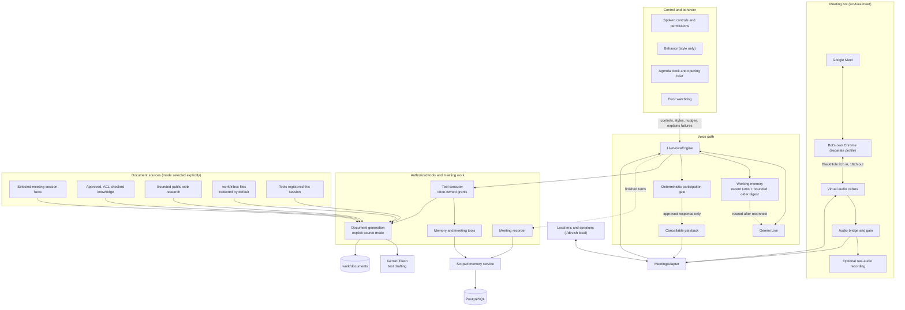
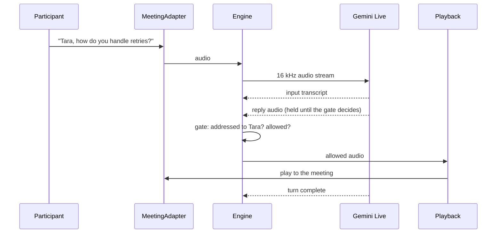
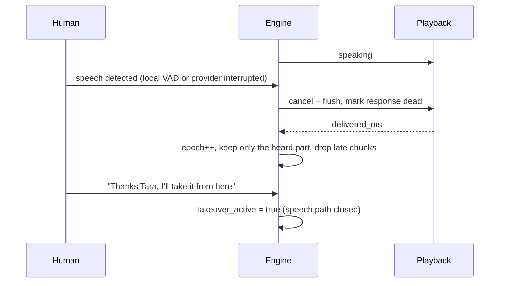
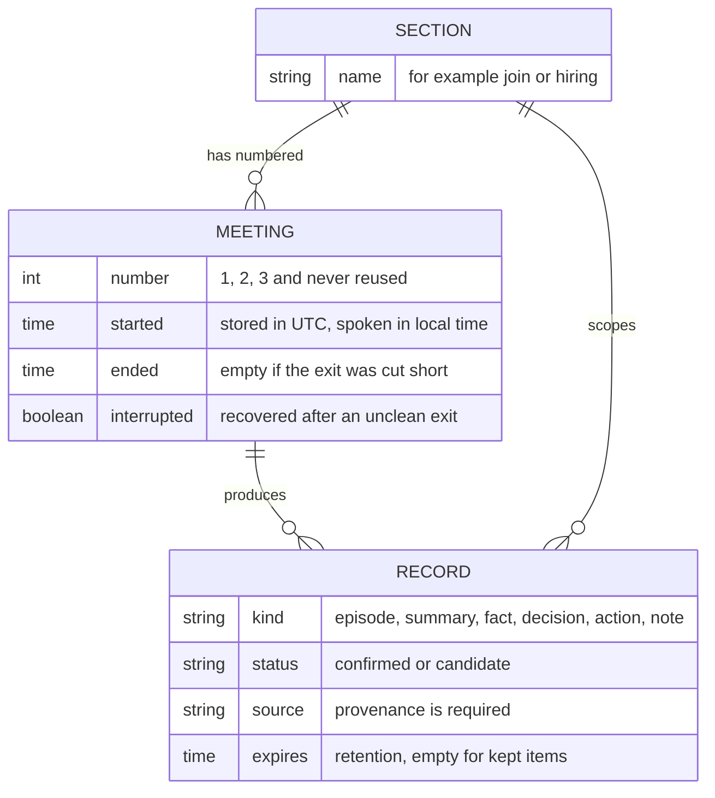
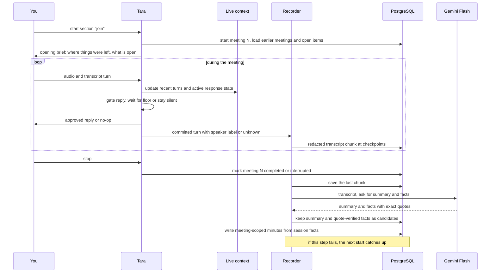
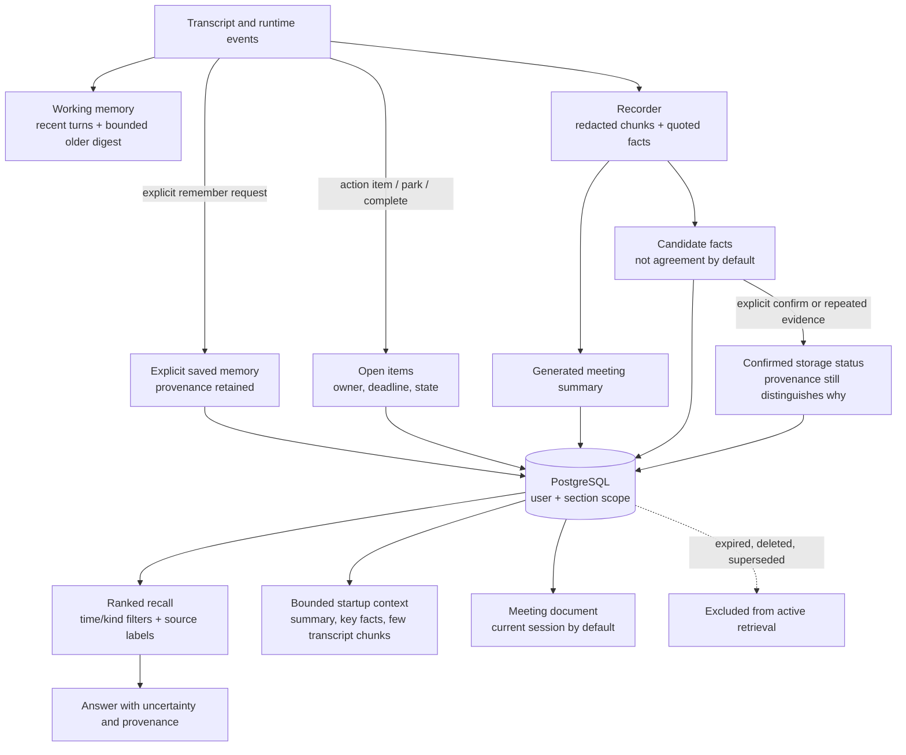

# Tara 🎙️

### An AI team member that knows when to talk, and when not to.

## What is Tara?

Tara is an AI participant for live meetings. She joins a conversation by voice, works out why she is there, tracks who is speaking, and takes part only as far as the organizer's rules and the live state of the conversation allow. She can interview a candidate, sit in on a team meeting and take the minutes, present a product from approved material, or simply listen and remember.

Most meeting bots transcribe. Tara takes part. The difference is judgement: a model that speaks whenever it has something to say is worse than silence in a hiring interview or a customer call. So Tara is built on one rule: **deterministic code owns the floor, permissions, identity and tools, and the language model only proposes.**

**Current status:** Tara is a Python backend with a Gemini Live voice path, PostgreSQL memory, meeting tools, interviews, and document generation. Offline behavior is tested. One real text-to-audio Gemini smoke test has run; real conversational quality, multi-speaker attribution, and end-to-end Google Meet behavior remain unverified. Check the [changelog](CHANGELOG.md) for dated evidence and limits.

## Continuing Core-Intelligence Work

Start with the [Core Intelligence Gap Analysis](docs/architecture/CORE_INTELLIGENCE_GAP_ANALYSIS.md) for the current implementation map, remaining gaps, and recommended next task. Then use the [architecture index](docs/architecture/README.md) for component details and the [changelog](CHANGELOG.md) for recent changes and verification results. The changelog is a project record; tools and new sessions do not automatically load it, so use this section as the explicit starting point.

---

## Features

### Conversation
- **Natural voice** with Gemini Live: speech in, speech out. Latency and conversational quality are not yet established by a representative evaluation.
- **Knows when to speak.** Being addressed, being invited, being told to be quiet, being interrupted and being taken over are separate states, not one flag.
- **Interruption handling.** Speech from a human cancels Tara mid-sentence, and history keeps only what was actually heard.
- **Human takeover.** "Thanks Tara, I'll take it from here" closes her speech path at once.
- **Identity as evidence.** A speaker can be `unknown`. Candidate A's answer never becomes Candidate B's.
- **A personality, not a script.** Profiles (`professional`, `conversational`, `expressive`) shape tone and length. They never decide whether she speaks.

### Memory
- **Keeps the meeting without being asked.** When work and PostgreSQL memory are enabled, Tara stores redacted transcript chunks, a generated summary, and candidate facts, so nobody has to say "remember this". Saying it still works and records an explicit save.
- **Sections and numbered meetings.** A section is like a chat. Every run of the same section is its next numbered meeting (meeting 1, meeting 2, ...), stored with its date and time. Ask "what did we talk about last meeting?", "what was meeting two?" or "which meetings have we had?". Section-scoped records stay separate; explicitly global memories may be visible across sections.
- **Editable.** Say "delete the last meeting" and Tara removes it, asking "are you sure?" first when it held something important. Say "that's wrong, it's Monday" and she updates the memory, keeping the old version as history.
- **Careful by design.** Automatically extracted facts are candidates and require a supporting quote; repeated sightings do not mean the team explicitly agreed. Sensitive-text detection and redaction are heuristic, not a guarantee. Expired transcript chunks and candidate facts are purged at session startup according to configured retention.
- **Carries over.** The next session of a meeting starts with its summary and key facts, and Tara looks things up when asked and says plainly when nothing is recorded.

### Running a meeting
- **Open items that carry over.** Action items (owner and deadline) and parked topics stay open from meeting to meeting. Ask "what's still open?" or say "the budget one is done".
- **Opening brief.** When a continuing section starts, Tara speaks first: where things were left and what is still open.
- **Agenda and time-keeping.** Set an agenda and a length; Tara tracks what is covered and gives quiet nudges ("five minutes left").
- **Recap and catch-up.** "Recap so far" and "what did I miss", plus a parking lot for off-topic points.
- **Names and jargon.** A word list (file, env, or by voice) so names are written correctly.
- **Meeting types.** Stand-up, one-to-one, retro, client call and brainstorm each change how Tara behaves and what the minutes look like (`./dev.sh local --type standup`).

### Secretary
- **Takes minutes** while the meeting runs: decisions, actions with owners, open questions.
- **Reminds the room** ("we said this earlier") when a confirmed item comes up again.
- **Recaps on demand.**

### Interviews
- **Give her a CV, a GitHub account or a portfolio link.** She reads them and builds interview questions from the role and the candidate's skills.
- **Runs the interview**, then grades each criterion with a verbatim quote from the candidate as evidence.
- **Returns a report** that always asks for human review. She never says hire or reject.
- **Create one from the terminal:** `./dev.sh interview new "Name"`, then `./dev.sh interview run <code>` (add `--meet` to run it in Google Meet) ([INTERVIEWS](docs/interviews/INTERVIEWS.md)).

### Documents
- **PDF, DOCX and Markdown** for interviews, meeting records, research topics, tool lists, approved company knowledge, or a file in `work/inbox`.
- `create_document_from_source` requires an explicit source mode plus title, audience, purpose, and length. Meeting documents use the current session unless a previous meeting is explicitly selected; source modes do not silently fall back to meeting notes.
- Web research includes source references; approved-knowledge search is scope/ACL constrained; provided files are path-confined and redacted by default. Citation IDs are checked for existence, not for semantic support. Live Gemini tool selection is unverified.

### Tools
Time zones, calculator, location, weather, public web pages, optional web search (Brave or Tavily), and bounded background research.

### Safety
If something fails Tara says so out loud and the screen shows a problem line. A disclosure string is required in meeting configuration, but participant consent and authenticated access are not complete end-to-end. Tool use is granted in code; raw audio is not stored by default; secrets are not logged; CV, web, provided-file, and transcript text are treated as untrusted data.

---

## Architecture

Deterministic code sits between the model and the meeting. Gemini Live proposes replies and tool calls. Our code decides who may be heard, when playback stops, which tools run and what is persisted. Live working memory, meeting notes, and durable PostgreSQL memory are separate stores, not yet one unified structured meeting-context projection.



Memory tools cover explicit save/recall/update/forget and meeting history. Automatic transcript chunks and candidate facts are stored when work and memory are enabled. Meeting tools cover open items, agenda, recap, meeting type and vocabulary. Document source modes are meeting, web research, active tool catalog, approved knowledge, and provided inbox material. Web research requires `TARA_TOOLS_SEARCH=1` and `TARA_SEARCH_API_KEY`. Approved knowledge requires memory, `TARA_KNOWLEDGE_ENABLED=1`, and content ingested and approved through `tara knowledge`. Working memory is re-seeded after reconnect as untrusted transcript data. Metrics are intended to carry no conversation content. Details are in [SYSTEM_ARCHITECTURE](docs/architecture/SYSTEM_ARCHITECTURE.md) and [CORE_INTELLIGENCE_GAP_ANALYSIS](docs/architecture/CORE_INTELLIGENCE_GAP_ANALYSIS.md).

Tara is cloud-backed: audio and transcripts go to Google. Details: [GEMINI_LIVE](docs/engine/GEMINI_LIVE.md), [SYSTEM_ARCHITECTURE](docs/architecture/SYSTEM_ARCHITECTURE.md).

### One interaction


### Interruption and takeover


### Sections and numbered meetings
A section is a chat. Every run of the same section is its next numbered meeting. Memory never crosses sections.


### The life of a meeting


### How memory is organized


### Where things live
| Area | Code |
|---|---|
| Gemini Live adapter and voice contracts | [voice/](src/tara/voice/) |
| Shared foundation (config, contracts, errors, settings, metrics, state) | [core/](src/tara/core/) |
| Participation gate, floor, identity | [floor/](src/tara/floor/), [voice/participation.py](src/tara/voice/participation.py) |
| Behaviour (style only) | [behaviour/](src/tara/behaviour/) |
| Memory | [memory/](src/tara/memory/), [secretary/](src/tara/secretary/) |
| Meeting features (open items, agenda, vocabulary, types, brief) | [meetings/](src/tara/meetings/) |
| Interviews | [hiring/](src/tara/hiring/) |
| Documents | [docgen/](src/tara/docgen/) |
| Tools: executor, catalogue (`tara tools`), utility tools | [tools/](src/tara/tools/), [tools/utility/](src/tara/tools/utility/) |
| Secretary, document and interview tools for a session | [work/](src/tara/work/) |
| Command line (`tara ...`) | [cli.py](src/tara/cli.py) |
| Dormant local-model engine (not used live) | [legacy/](src/tara/legacy/) |
| Fakes and simulation for tests | [testing/](src/tara/testing/) |

---

## How to run it

You need Python 3.11+ and a Gemini API key from [Google AI Studio](https://aistudio.google.com/).

**1. Install**
```bash
make setup        # creates .venv with Python 3.11+ and installs every extra (pip install -e ".[all]")
```

**2. Configure.** Copy [.env.example](.env.example) to `.env` (git-ignored) and fill in the keys (every other option has a default; the full list is [env.full.example](env.full.example)):
```
GEMINI_API_KEY=<your key>
TARA_LIVE_MODEL=<a Gemini Live model id from ai.google.dev/gemini-api/docs/models>
TARA_LLM_MODEL=<a Gemini Flash text model id, for documents and minutes>
TARA_WORK_ENABLED=1                 # secretary, interviews, documents
TARA_MEMORY_ENABLED=1               # remember across meetings
TARA_MEMORY_DATABASE_URL=postgresql:///tara_memory
```
`TARA_GITHUB_TOKEN` is optional and raises the GitHub rate limit.

**3. Set up memory (PostgreSQL)**
```bash
createdb tara_memory
.venv/bin/python -m tara.memory.migrate
```

**4. Join a meeting (the main way to use Tara).** One-time setup for the bot's own Google account and the two virtual audio cables is in [GOOGLE_MEET_BOT](docs/google-meet/GOOGLE_MEET_BOT.md). After that:
```bash
./dev.sh                                  # asks "Which meeting?", then joins (Enter reuses the last link)
./dev.sh https://meet.google.com/abc-defg-hij   # same, no question
```
Both run exactly this, which you can also type yourself:
```bash
./dev.sh meet join https://meet.google.com/abc-defg-hij --audio devices --half-duplex --transcripts --model-wake
```
Tara joins as her own participant, waits to be admitted, and shows her picture as the camera. She listens and takes notes the whole time and answers only when called ("Hey Tara", at the start, middle or end of a sentence); for 8 seconds after an answer you can keep talking without her name. Useful extras: `--record` (save the audio as WAV files, tell everyone first), `--reply-to-all`, `--no-camera`, `--no-gain`, `--follow-up 0`.

**5. Run an interview (the other way in).** Create one from the terminal: drop a GitHub link and a CV, say how many questions and how hard, and get a code.
```bash
./dev.sh interview new "Feremi"             # asks for the role, GitHub, portfolio and CV (drag the file in)
./dev.sh interview run feremi --meet        # asks for the meeting link, then runs it inside Google Meet
./dev.sh interview run feremi               # or on this computer only (you play the candidate)
./dev.sh interview list                     # prepared interviews and results
```
Reports are written to `work/documents`. See [INTERVIEWS](docs/interviews/INTERVIEWS.md).

**Local only, no meeting.** To talk to Tara on this computer (headphones give the best result; give the section a name to keep its memory separate):
```bash
./dev.sh local --headphones
./dev.sh local --section join      # the next numbered meeting of section 'join'
./dev.sh local --list              # sections and their meetings with dates
```
Say "Tara, ..." to get her attention.

**6. Run the tests**
```bash
.venv/bin/python -m pytest -q
.venv/bin/ruff check src tests && .venv/bin/mypy src
```

More: [LOCAL_DEVELOPMENT](docs/getting-started/LOCAL_DEVELOPMENT.md), [CONFIGURATION](docs/getting-started/CONFIGURATION.md), [WORKFLOWS](docs/meetings/WORKFLOWS.md).

---

## Sample

An illustrative one-on-one session.

```text
You:   Tara, we're hiring a backend engineer. Prepare Alex from the inbox, GitHub alexkim.
Tara:  On it. I'll tell you when the interview plan is ready.
Tara:  Alex's plan is ready: six questions on Go, PostgreSQL and API design.
You:   Start the interview.
Tara:  Alex, thanks for joining. First question: how would you stop a payment
       from being charged twice if the client retries?
Alex:  I'd use an idempotency key with a unique constraint, inside a transaction.
Tara:  Good. What happens if two requests with the same key arrive together?
...
You:   Finish the interview and make a PDF report.
Tara:  Done. The report is in work/documents. It includes scores with Alex's own
       words as evidence, and it needs a human decision.
You:   Remember we agreed to send the offer decision by Friday.
Tara:  Saved.
```

Next meeting:
```text
You:   What did we decide last time?
Tara:  You agreed to send the offer decision by Friday.
```

---

## What is next
The Google Meet browser adapter has been exercised in real calls, but complete meeting behavior, robust multi-speaker attribution, interruptions, and reconnects remain unverified; see [GOOGLE_MEET_BOT](docs/google-meet/GOOGLE_MEET_BOT.md) and the [changelog](CHANGELOG.md). The current core-intelligence continuation plan is [CORE_INTELLIGENCE_GAP_ANALYSIS](docs/architecture/CORE_INTELLIGENCE_GAP_ANALYSIS.md). Calendar roster, teams, a web dashboard, and meaning-based/vector search remain future work: [GOOGLE_MEET_INTEGRATION](docs/google-meet/GOOGLE_MEET_INTEGRATION.md) and [DASHBOARD](docs/product/DASHBOARD.md). Emailing minutes through Resend is tested offline; no real email has been sent: [EMAIL_DELIVERY](docs/meetings/EMAIL_DELIVERY.md). Every command Tara understands, and which ones carry over to Meet, is in [COMMANDS](docs/getting-started/COMMANDS.md).

---

## Contributors

Contributions are welcome.

1. Read [AGENTS.md](AGENTS.md) and [CLAUDE.md](CLAUDE.md) for the rules.
2. Product intent is in [initial.md](initial.md), project history in [CHANGELOG.md](CHANGELOG.md), and all docs are indexed at [docs/README.md](docs/README.md).
3. Make your change on a branch, run `pytest`, `ruff check src tests` and `mypy src`, and update the docs and changelog when behaviour changes.
4. Never commit keys, `.env` files, candidate data or the `work/` folder.

**Pull requests are open.** Small, focused PRs with tests are easiest to review.

## License

MIT. See [LICENSE](LICENSE).

*A good meeting participant is mostly someone who knows when not to speak.*
