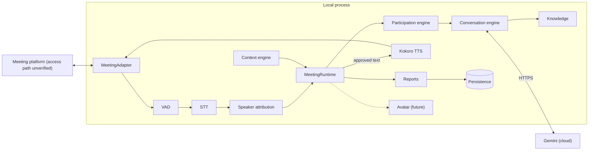
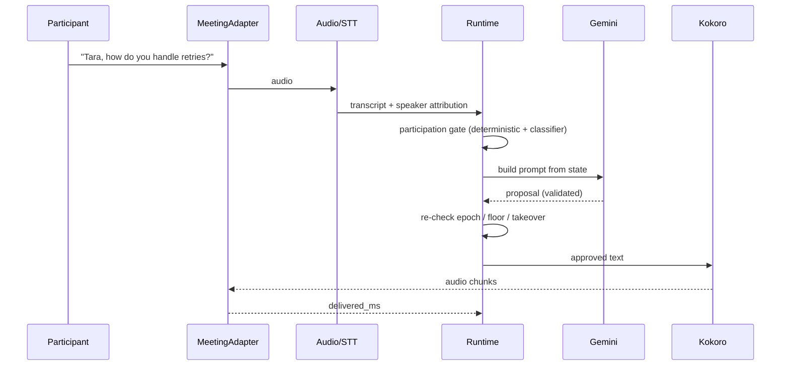
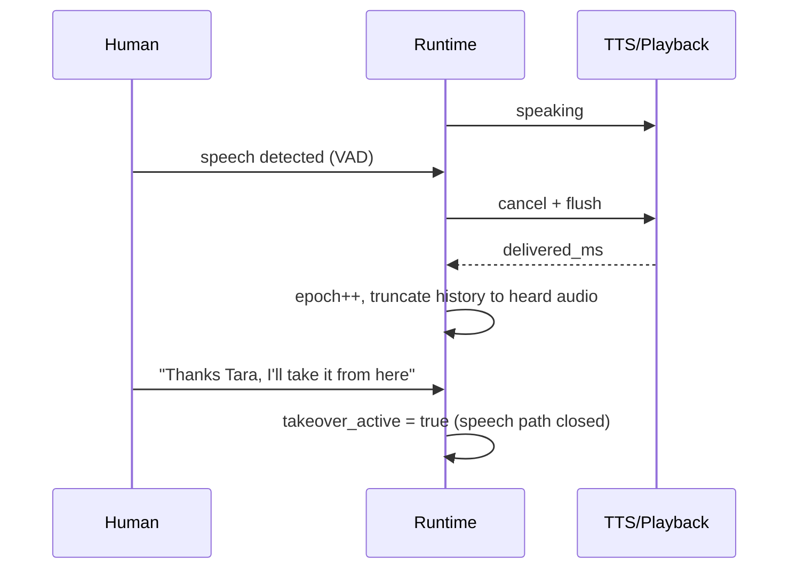

# Tara 🎙️

### An AI team member that knows when to talk, and when not to.

Tara joins your meeting, works out why it exists, tracks who is speaking, and takes part only as far as the organizer's rules and the live state of the conversation allow. It can run an interview, sit in on an engineering meeting, pitch a product from approved docs, or just listen and write the notes.

> **Honest status:** the decision-making core and the async engine are written and tested with fakes (**144 offline tests passing**). Real audio models, Gemini calls and Google Meet have **not** been run yet. See [what works today](#-what-works-today).

---

## 💡 The problem
Meeting bots transcribe. They do not interview, they do not represent a product, and they do not know when to stay quiet. A model that speaks whenever it has something to say is worse than silence in a hiring interview or a customer call, and a model that mixes up two candidates can quietly corrupt a hiring decision.

## 🧠 The idea
One engine, configured per meeting. **Deterministic code owns the floor, permissions, identity and tools. The language model only proposes.**

| Principle | What it means in practice |
|---|---|
| 🧭 Context becomes validated config | Organizer prose is input. Permissions come from app policy, so "you may email candidates" creates nothing. |
| 🗣️ Participation is a state machine | Listening, being addressed, being invited, being told to be quiet, being interrupted and being taken over are separate states. |
| 🪪 Identity is evidence, not a guess | A speaker can be `unknown`. Candidate A's answer can never silently become Candidate B's. |
| ⏱️ Stale answers die | Every proposal carries an epoch. If the room moved on, the answer is dropped. |
| 📚 Grounded pitching | Product claims must cite approved passages, or Tara says she does not know. |
| 🛑 Human takeover is first class | "Thanks Tara, I'll take it from here" closes the speech path immediately. |

## 🏗️ Architecture
Planned shape. Components marked planned or unverified are not running yet.


Full diagram with every component: [SYSTEM_ARCHITECTURE](docs/SYSTEM_ARCHITECTURE.md). Gemini is cloud, so Tara is **not offline** and transcripts leave the machine.

## 🔄 One interaction


## ✋ Interruption and takeover
Modeled on how production live-voice systems behave: speech onset cancels the response, and history keeps only what was actually heard. Reference notes: [LIVE_VOICE_REFERENCE](docs/research/LIVE_VOICE_REFERENCE.md).


## 🧩 Memory and knowledge (designed, not built)
Live conversation state stays in process and is never replaced by search. Knowledge comes from approved documents in PostgreSQL with pgvector, retrieved with keyword plus vector search, authorization applied inside the query, every fact carrying its source. Meeting memory keeps decisions and actions as *candidates* until confirmed, so a transcript line never silently becomes a fact. Design: [MEMORY_AND_RAG](docs/MEMORY_AND_RAG.md), [CONTEXT_ASSEMBLY](docs/CONTEXT_ASSEMBLY.md), [security](docs/MEMORY_AND_RETRIEVAL_SECURITY.md). Today only a keyword-overlap stand-in exists in [knowledge.py](src/tara/knowledge.py).

## ✅ What works today
Everything below runs offline against fakes. **None of it has touched a real microphone, model, Gemini key or Meet call.**

| Module | File | What it does |
|---|---|---|
| Config validator | [config.py](src/tara/config.py) | Validates a meeting config against app policy; prose cannot grant tools |
| Context engine | [context.py](src/tara/context.py) | Organizer text to validated config; malformed model output becomes issues, never a crash |
| Runtime | [runtime.py](src/tara/runtime.py) | State machine, epochs, takeover, dedupe, proposal approval |
| Participation gate | [participation.py](src/tara/participation.py) | Decides allow, wait, ask, refuse, mute or takeover |
| Intent classifier | [classify.py](src/tara/classify.py) | Rule and LLM classifiers; ASR-tolerant name hint ("Tara" yes, "Sara" no) |
| Audio | [audio.py](src/tara/audio.py) | Bounded buffers, resampling, VAD segmenter with pre-roll and hangover |
| Turn detection | [turn.py](src/tara/turn.py) | A pause is evidence, not proof; interviews wait longer |
| Speaker identity | [identity.py](src/tara/identity.py) | Versioned label maps, evidence fusion, `unknown` by default |
| Evidence and interviews | [evidence.py](src/tara/evidence.py), [interview.py](src/tara/interview.py) | Round-robin turns, follow-up limits, evidence that cannot cross candidates |
| Conversation | [conversation.py](src/tara/conversation.py) | Prompt assembly, schema validation, commitment and grounding checks |
| Tools | [tools.py](src/tara/tools.py) | Allow-listed, schema-checked, human-approval aware |
| Reports | [reports.py](src/tara/reports.py) | Interview, decision and pitch reports from stored evidence only |
| Engine | [engine.py](src/tara/engine.py) | Async pipeline with cancellation, barge-in, takeover, reconnect, echo guard |
| Gemini provider | [providers/gemini.py](src/tara/providers/gemini.py) | REST client with bounded retries; tested with a fake transport only |
| Local model adapters | [providers/local_models.py](src/tara/providers/local_models.py) | mlx-whisper, Kokoro, Silero wrappers; **untested, nothing downloaded** |

## 🚧 What does not work yet
- No real speech recognition, speech synthesis or VAD model has been run.
- No live Gemini call has been made. The request shape is from the public docs and needs a real key to confirm.
- No Google Meet connection. The official Meet Media API is Developer Preview and closed to new signups, so the plan is an unofficial browser participant or a third-party bot API ([GOOGLE_MEET_RESEARCH](docs/GOOGLE_MEET_RESEARCH.md), [spike plan](docs/research/PHASE0_MEET_SPIKE.md)).
- No latency numbers exist. Nothing is claimed real-time until measured.
- No avatar. It is a future extension behind `AvatarProvider`.

## 🛠️ Stack
Python 3.13 (3.11+ required) · stdlib only for the core · Gemini Flash (model id comes from config) · Whisper family via mlx-whisper or faster-whisper (to benchmark) · Silero VAD · Kokoro-82M · optional pyannote diarization. FastAPI and WebSocket control API are planned, not built.

## ▶️ Run the tests
```bash
python3.13 -m venv .venv
.venv/bin/pip install pytest
.venv/bin/python -m pytest -q
```
No models are downloaded and no credentials are needed. Model setup is deliberately deferred to Phase 2: [LOCAL_DEVELOPMENT](docs/LOCAL_DEVELOPMENT.md). Config template: [.env.example](.env.example).

## 🔐 Security and privacy
AI-presence disclosure is required before a meeting starts. Raw audio is not stored by default. API keys are read from the environment, sent in a header, and never logged. Interview reports are decision support and always say human review is required. More: [SECURITY_AND_PRIVACY](docs/SECURITY_AND_PRIVACY.md).

## 🗺️ Roadmap
Phase 1 core and engine: done against fakes. Next: real model integrations (Phase 2), speaker intelligence (3), real meeting integration (4), then interviews, general meetings, product pitch and avatar. Detail and acceptance criteria: [IMPLEMENTATION_ROADMAP](docs/IMPLEMENTATION_ROADMAP.md).

## 📖 Documentation
Start at [docs/README.md](docs/README.md). Project history and handover notes: [CHANGELOG.md](CHANGELOG.md). Open questions: [OPEN_QUESTIONS](docs/research/OPEN_QUESTIONS.md). Sources with access dates: [SOURCES](docs/research/SOURCES.md). Product intent: [initial.md](initial.md).

## 🤝 Contributing
Read [AGENTS.md](AGENTS.md) and [CLAUDE.md](CLAUDE.md) first. Update the docs whenever behavior changes.

## 📄 License
None chosen yet.

*A good meeting participant is mostly someone who knows when not to speak.*
