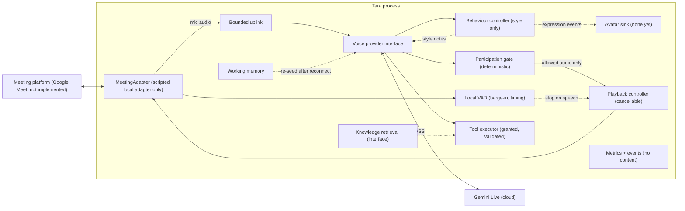
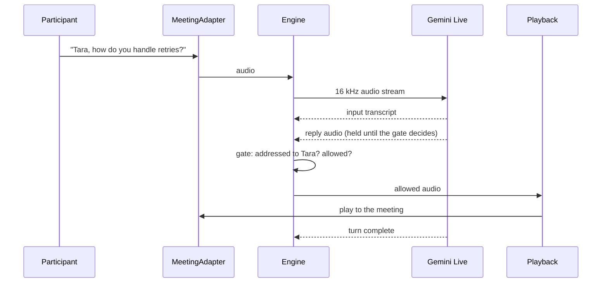
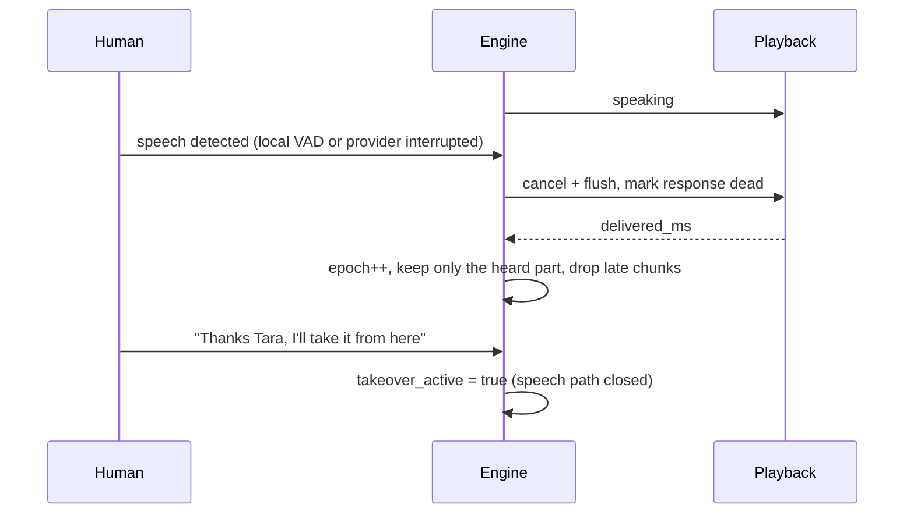

# Tara 🎙️

### An AI team member that knows when to talk, and when not to.

Tara joins your meeting, works out why it exists, tracks who is speaking, and takes part only as far as the organizer's rules and the live state of the conversation allow. It can run an interview, sit in on an engineering meeting, pitch a product from approved docs, or just listen and write the notes.

> **Honest status:** Tara's voice engine is **Gemini Live**, integrated behind our own interfaces and tested with scripted fakes and the real SDK's types (**367 offline tests passing**). One real one-turn smoke test now passes against the hosted service: **1.77 s connect, 1.04 s to first audio, 24 kHz output**. The owner has run a real microphone/headphone conversation; the full live behaviour suite, real interruption/reconnect, and Google Meet are **not** tested. **No local model is downloaded or used.** See [what works today](#-what-works-today) and [GEMINI_LIVE](docs/GEMINI_LIVE.md).

---

## 💡 The problem
Meeting bots transcribe. They do not interview, they do not represent a product, and they do not know when to stay quiet. A model that speaks whenever it has something to say is worse than silence in a hiring interview or a customer call, and a model that mixes up two candidates can quietly corrupt a hiring decision.

## 🧠 The idea
One engine, configured per meeting. **Deterministic code owns the floor, permissions, identity and tools. The language model only proposes.**

| Principle | What it means in practice |
|---|---|
| 🧭 Context becomes validated config | Organizer prose is input. Permissions come from app policy, so "you may email candidates" creates nothing. |
| 🗣️ Participation is a state machine | Listening, being addressed, being invited, being told to be quiet, being interrupted and being taken over are separate states. |
| 🪪 Identity is evidence, not a guess | A speaker can be `unknown`. Candidate A's answer can never silently become Candidate B's. |
| ⏱️ Stale answers die | Every proposal carries an epoch. If the room moved on, the answer is dropped. |
| 📚 Grounded pitching | Product claims must cite approved passages, or Tara says she does not know. |
| 🛑 Human takeover is first class | "Thanks Tara, I'll take it from here" closes the speech path immediately. |

## 🏗️ Architecture
What exists today. The only meeting transport is a scripted local adapter; Google Meet is not implemented.


Gemini Live understands, answers and speaks; **our code decides who may be heard, when playback stops, which tools run and what is remembered.** Gemini is cloud, so Tara is **not offline** and audio and transcripts leave the machine. Details: [GEMINI_LIVE](docs/GEMINI_LIVE.md).

## 🎭 Conversational behaviour
Tara is meant to sound like a thoughtful colleague, not a call-centre script. A small behaviour layer (profiles `professional` by default, `conversational`, `expressive`) reads the room with cheap lexical cues (joke, bad news, correction, urgency, confusion), keeps humour out of serious or sensitive moments and interviews, rate-limits laughter-type reactions, adapts answer length after interruptions or rambling, sends short style notes to the live model, flags stock phrases and human-experience claims in its own words, and emits validated expression events for a future avatar. **It cannot decide whether Tara may speak; the participation gate still does, and mute, takeover and interruption always win.** What is verified: the logic (tests). What is not: how it sounds, because the one-turn smoke audio was not evaluated and no behaviour scenario has been run. The docs say what Gemini Live does and does not support for expression: [CONVERSATIONAL_BEHAVIOUR](docs/CONVERSATIONAL_BEHAVIOUR.md).

## 🔄 One interaction


## ✋ Interruption and takeover
Modeled on how production live-voice systems behave: speech onset cancels the response, and history keeps only what was actually heard. Reference notes: [LIVE_VOICE_REFERENCE](docs/research/LIVE_VOICE_REFERENCE.md).


## 🧩 Memory and knowledge (designed, not built)
Live conversation state stays in process and is never replaced by search. Knowledge comes from approved documents in PostgreSQL with pgvector, retrieved with keyword plus vector search, authorization applied inside the query, every fact carrying its source. Meeting memory keeps decisions and actions as *candidates* until confirmed, so a transcript line never silently becomes a fact. Design: [MEMORY_AND_RAG](docs/MEMORY_AND_RAG.md), [CONTEXT_ASSEMBLY](docs/CONTEXT_ASSEMBLY.md), [security](docs/MEMORY_AND_RETRIEVAL_SECURITY.md). Today only a keyword-overlap stand-in exists in [knowledge.py](src/tara/knowledge.py).

## ✅ What works today
Most of this is verified offline against fakes and the SDK's real data types. **One real one-turn Gemini Live smoke test has run; nothing has used a real microphone or a real meeting, and live behaviour, interruption and reconnect remain unverified.**

| Area | Where | What it does |
|---|---|---|
| Gemini Live adapter | [voice/gemini_live.py](src/tara/voice/gemini_live.py) | Connects through the official SDK, maps provider messages to our neutral events, builds the session config, classifies errors, redacts the key |
| Voice interfaces | [voice/events.py](src/tara/voice/events.py) | Provider-neutral session contract; no Google type leaves the adapter |
| Live engine | [voice/engine.py](src/tara/voice/engine.py) | Uplink with backpressure, interruption (provider event and local barge-in), stale-audio rejection, gating, tools, reconnect and resumption, limits |
| Playback | [voice/playback.py](src/tara/voice/playback.py) | Bounded per-response queues, immediate cancel, stale chunk rejection |
| Local audio demo | [adapters/audio_device.py](src/tara/adapters/audio_device.py), [voice/demo.py](src/tara/voice/demo.py) | Default microphone at 16 kHz; output resampled to the device rate; same gate, no Meet; fake-backend tests plus an owner headphone run; `--speaker` half-duplex avoids echo feedback |
| Participation gate | [voice/participation.py](src/tara/voice/participation.py) | Addressed or not, silent policy, mute, takeover by a trusted role, identity in interviews |
| Conversational behaviour | [behaviour/](src/tara/behaviour/) | Profiles, room-reading signals, humour and verbosity rules, style notes, output quality checks, avatar-ready expression events, floor etiquette (waits while someone is mid-sentence) |
| Memory interfaces | [voice/memory.py](src/tara/voice/memory.py) | Working memory, scoped meeting memory with provenance, scope-bound knowledge search |
| Tools | [tools.py](src/tara/tools.py) | Granted, typed, time-limited, audited; side effects need approval |
| Settings and metrics | [settings.py](src/tara/settings.py), [metrics.py](src/tara/metrics.py) | Validated environment config; latency and failure counters |
| Deterministic core | [config.py](src/tara/config.py), [runtime.py](src/tara/runtime.py), [participation.py](src/tara/participation.py), others | Meeting config validation, floor state machine, identity, evidence, reports |
| Optional local path (dormant) | [engine.py](src/tara/engine.py), [providers/](src/tara/providers/) | The earlier cascaded STT, router, LLM, TTS runtime; kept and tested with fakes, not started, **no models downloaded** |

## 🚧 What does not work yet
- Only one real text-in/audio-out Gemini Live smoke turn has run: audio input, playback audibility, event ordering under interruption, tool behavior and speech-to-speech latency are unverified ([smoke test](#-run-it)).
- The local audio-device demo has not been run on real hardware yet, and there is **no Google Meet connection**. The official Meet Media API is Developer Preview and closed to new signups; the plan is a browser participant or a third-party bot API ([GOOGLE_MEET_RESEARCH](docs/GOOGLE_MEET_RESEARCH.md)).
- Speaker identity is unknown on mixed audio.
- No RAG or database; memory is in-memory stand-ins.
- No vocal expression is verified (laughter, tone, pacing): the smoke call produced audio but nobody evaluated it, and no behaviour scenario has been run. The Live docs do not document controls for them.
- Only one text-turn latency sample exists (connect and first audio above); there is no speech-to-speech, playback or interruption latency measurement.
- No avatar.

## 🛠️ Stack
Python 3.13 (3.11+ required) · `google-genai` SDK for Gemini Live (optional extra, an API client not a model) · `sounddevice` for the local mic/speaker demo (optional extra) · stdlib for the rest of the core · FastAPI and a control API are planned, not built. **No local ML models are installed.**

## ▶️ Run it
```bash
python3.13 -m venv .venv
.venv/bin/pip install -e ".[dev,live,audio]"
.venv/bin/python -m pytest -q            # 367 offline tests: no network, no key
.venv/bin/ruff check src tests && .venv/bin/mypy src
```
Real-service smoke test (opt-in; makes one real API call; prints measurements only, never the key or transcripts):
```bash
export GEMINI_API_KEY=...                 # from Google AI Studio, never committed
export TARA_LIVE_MODEL=...                # a Live model id from the models page
.venv/bin/python -m tara.voice.smoke
TARA_LIVE_TEST=1 .venv/bin/python -m pytest -m live_api tests/live -q
```
Latest real result (2026-10-20, one text turn): `connect_ms` 1771.9, `first_audio_ms` 1039.4, `audio_bytes` 80160, `sample_rate` 24000, `turn_complete` true, 11 events. This is text-to-first-audio, not speech-to-speech, and playback was not listened to.

Local voice demo (microphone in, Tara's voice out; **headphones are best** so her reply is not fed back into the mic):
```bash
set -a; source .env; set +a              # or export the two variables above
.venv/bin/python -m tara.voice.demo --one-on-one          # headphones: full duplex
.venv/bin/python -m tara.voice.demo --one-on-one --speaker  # speakers: mic is muted while Tara speaks
```
`--one-on-one` replies to any speech from the single participant, which is what you want for a solo voice demo. Without it, the normal meeting rule applies and you must say “Tara, …”. `--speaker` prevents the speaker echo from being sent back; it disables voice barge-in, so press `Ctrl+C` to stop. The demo replies in English and uses the default input and output devices, not Google Meet. The adapter and CLI are covered by fake-backend tests; the owner has run the headphone conversation on real hardware, and the speaker mode is the supported workaround for feedback. Add `--debug` to print non-content counters (input transcripts, gate outcomes, playback failures) when a run does not reply.
Config template: [.env.example](.env.example) (placeholders only). More: [LOCAL_DEVELOPMENT](docs/LOCAL_DEVELOPMENT.md).

## 🔐 Security and privacy
AI-presence disclosure is required before a meeting starts. Raw audio is not stored by default. The Gemini key lives only on the server, is read from the environment, and is redacted from every error; audio and transcripts do go to Google, and the pricing page says free-tier data may be used to improve Google products, so use a paid tier for real interviews. Interview reports are decision support and always say human review is required. More: [SECURITY_AND_PRIVACY](docs/SECURITY_AND_PRIVACY.md).

## 🗺️ Roadmap
A real one-turn smoke test is done, and the local audio-device demo is implemented and fake-backend tested. Next: run the demo on real hardware, run the full live behaviour suite, then the Google Meet transport spike, then interviews, pitch, speaker attribution and memory/RAG. The old plan to download local models is cancelled. Detail: [IMPLEMENTATION_ROADMAP](docs/IMPLEMENTATION_ROADMAP.md).

## 📖 Documentation
Start at [docs/README.md](docs/README.md). Project history and handover notes: [CHANGELOG.md](CHANGELOG.md). Open questions: [OPEN_QUESTIONS](docs/research/OPEN_QUESTIONS.md). Sources with access dates: [SOURCES](docs/research/SOURCES.md). Product intent: [initial.md](initial.md).

## 🤝 Contributing
Read [AGENTS.md](AGENTS.md) and [CLAUDE.md](CLAUDE.md) first. Update the docs whenever behavior changes.

## 📄 License
None chosen yet.

*A good meeting participant is mostly someone who knows when not to speak.*
