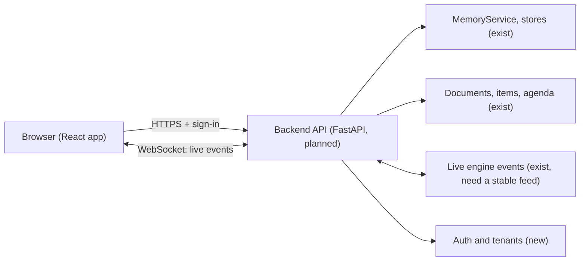

# Dashboard (front end) design

**Status: designed, not built.** The project is backend only today (no web server, no UI). This page says what the dashboard shows, what it can already reuse from the backend, what API must be added, and in what order to build it. It is part of the Google Meet phase plan (M7 in [GOOGLE_MEET_INTEGRATION](GOOGLE_MEET_INTEGRATION.md)); every action listed here is also available by voice or terminal ([COMMANDS](COMMANDS.md)).

## Purpose
Voice is good for running a meeting and poor for browsing, editing and exporting. The dashboard is the place to **watch a meeting live, review what was kept, fix it, and take it away**, without needing a database client.

## Principles
- **Read the same truth as the voice path.** The dashboard never keeps its own copy of memory; it calls the backend, which uses the same stores.
- **No secrets in the browser.** Keys stay on the server. The browser gets a session, not API keys.
- **Scope comes from sign-in, never from a request field.** Tenant, user and section checks happen on the server (same rule as memory today).
- **Humans edit, the model proposes.** Everything the model stored automatically is labelled unconfirmed and can be confirmed, edited or deleted here.
- **No hidden speech.** The dashboard cannot make Tara speak unless an action is explicit and goes through the same gate.

## Pages

| Page | What it shows | Actions |
|---|---|---|
| **Live meeting** | live transcript with speaker names, who is speaking, Tara's state (listening, speaking, muted, takeover), agenda with timer, notes and action items as they are captured, connection health | mute or silence Tara, take over, add a note or action item, mark agenda items, set meeting type, end the meeting |
| **Sections** | all sections (chats) and their numbered meetings with date, time and length | open, rename, share, export, delete a meeting (with the same "are you sure" rule for important ones) |
| **Meeting detail** | summary, key facts (confirmed vs unconfirmed), decisions, actions, parked topics, transcript chunks, minutes documents | confirm or edit a fact, complete an action, regenerate the summary, make a PDF or DOCX, download |
| **Open items board** | everything still open across a section, grouped by owner and deadline, with the meeting it came from | add, edit, reassign, complete, snooze |
| **Memory browser** | every stored memory with kind, status, source, meeting, dates; search | edit (supersedes, keeps history), forget, export, filter by section |
| **Documents** | generated minutes and reports with fonts and layout chosen | preview, download, regenerate |
| **Interviews** (later) | candidates, plans, graded reports, flags for human review | review, add human notes, export |
| **Settings** | meeting types and templates, word list (names and jargon), time nudges, retention periods, which keys are configured (status only, never values) | edit |
| **Health** | session status, latency, failures, costs (from metrics) | none |

## What the backend already provides
| Dashboard need | Backend today |
|---|---|
| list sections and meetings | `MemoryStore.list_meetings`, `list_sessions` |
| meeting contents | `list_session_items`, `MemoryService.assess_meeting`, `meeting_brief` |
| memory search and recent | `MemoryService.recall`, `store.list_recent` |
| edit and history | `remember(..., supersedes_id=...)`, status `superseded` |
| delete (soft) with importance check | `delete_meeting`, `delete_session`, `assess_meeting` |
| open items | `OpenItems.open_items`, `add`, `complete`, `describe` |
| documents | `DocumentStore`, `DocumentComposer`, job board |
| retention | `purge_expired`, retention settings |
| metrics and events | `Metrics`, `EventBus` (event names `live.*`, content-free) |

## What must be added
1. **Backend API** (FastAPI is already the planned choice, [API_AND_EVENT_CONTRACTS](API_AND_EVENT_CONTRACTS.md)): REST for sections, meetings, memory, items, documents, settings; one WebSocket for live events.
2. **A content-bearing live feed.** The current event bus is deliberately content-free (counters and ids). The dashboard needs transcript text, notes and items, so add a separate, authenticated feed for it; the content-free bus stays as is for logs and `--debug`.
3. **Auth and tenants** (M6): sign-in, session cookies, per-request scope.
4. **Edit and confirm operations** exposed as explicit endpoints (confirm a fact, edit a memory, reassign an owner) that reuse the memory service and write the same provenance.
5. **Export** (JSON and Markdown per section) and delete-all for data rights.
6. **Rate limits and audit log** for destructive actions.

## Live event feed (sketch)
| Event | Payload (content only for authenticated viewers of that section) |
|---|---|
| `transcript.turn` | speaker name or `unknown`, text, time, meeting number |
| `tara.state` | listening, speaking, muted, listen_only, takeover, reconnecting |
| `item.added` / `item.completed` | id, type, text, owner, deadline |
| `agenda.changed` | items and states, minutes left |
| `meeting.started` / `meeting.ended` | number, times |
| `problem` | plain-language error (same text shown on screen in the terminal today) |

## Security notes
- Viewing a live transcript is as sensitive as being in the meeting: only people on the roster or with explicit access may subscribe.
- Dashboard edits are attributed to the signed-in person; the model cannot call dashboard endpoints.
- Transcripts, memories and documents are untrusted text when rendered: escape everything, never render as HTML.
- Deleting is soft first; hard delete and export of all personal data need a confirmed request.

## Build order
1. API read endpoints (sections, meetings, memory, items) plus sign-in for one user.
2. Read-only pages: Sections, Meeting detail, Memory browser, Open items.
3. Edit and confirm actions with history.
4. Live feed and the Live meeting page.
5. Documents, settings (word list, meeting types, retention).
6. Teams: sharing, roles, tenants (with cross-tenant tests).
7. Interviews and health pages.

Technology is open: a plain React and TypeScript single page app talking to FastAPI is the default suggestion because the backend is Python and typed; choose when this is started. An avatar view (the static picture or a later animated one) is a separate panel behind the existing `AvatarProvider` interface ([AVATAR_RESEARCH](AVATAR_RESEARCH.md)).
