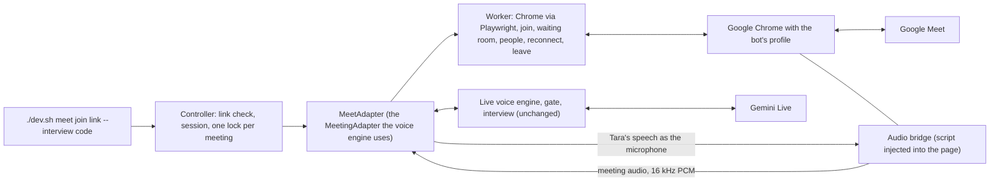

# Google Meet bot (Phase 2 foundation)

**Status: built and tested against a local stand-in for Meet in a real Chrome. Not yet run in a real Google Meet** (no bot account exists yet). What is proven and what is not is listed below; read that section before trusting anything.

Tara joins a meeting as a dedicated browser participant, hears the meeting, speaks into it, and runs the existing interview. The voice engine, the gate, the interview flow, scoring, the retry rule and the three-minute question limit are the ones already in the repo; none was rebuilt. The Meet code lives in `src/tara/meet/` and talks to the engine only through the `MeetingAdapter` interface.

## What is available from Google, checked 2026-10-21
| Question | Finding | Source |
|---|---|---|
| Can a bot get live audio from the official Meet Media API? | Not for a normal interview. It is still a **Developer Preview**: the Cloud project, the OAuth principal and **every participant** must be enrolled, and it delivers audio and video of only the three most relevant participants. Sending audio into a meeting is not documented. | Google Meet Media API pages and a Recall.ai write-up, see [SOURCES](research/SOURCES.md) (M4, M5) |
| Can we create meeting links? | Yes, with the Meet REST API: `POST https://meet.googleapis.com/v2/spaces`, scope `https://www.googleapis.com/auth/meetings.space.created`, needs OAuth. **Not set up here**; for now you create the meeting and pass the link. | Google `spaces.create` reference (M6) |
| So how does Tara get in? | As an ordinary participant through a browser, signed in as a dedicated bot account, with audio handled in the page. | this design |

Using a browser participant instead of an official media API may conflict with Google's terms and can break when the page changes. That risk is accepted knowingly for the first version and recorded here.

## Architecture

### The audio route (the hard part)
Playwright cannot move audio, so the **page** does it, with no system audio device and no extra software:
- **Meeting audio out:** a script injected before Meet loads wraps `RTCPeerConnection`. Every incoming audio track is tapped with Web Audio, mixed to mono, reduced from 48 kHz to 16 kHz PCM16 and sent to Python through an exposed function. Chrome runs with `--mute-audio`, so the bot machine does not play the meeting out loud; the taps are unaffected.
- **Tara's voice in:** `getUserMedia` is replaced. The "microphone" is a Web Audio destination that Python fills with Tara's 24 kHz speech chunks. Cancelling (barge-in) stops everything queued and reports how many milliseconds were actually played. No camera: a black frame is returned if video is asked for, and the worker also turns the camera off on the pre-join screen.
- **Nothing is recorded or stored.** Audio is passed through and dropped. The only thing on disk is the bot's Chrome profile (its Google cookies), under `work/` which is git-ignored.

Alternatives considered: a virtual audio device such as BlackHole plus system audio capture. It also works, but it needs a driver install, per-machine routing, and cannot separate Tara's output from other sounds; the in-page route needs neither. It stays the fallback if Meet blocks the page-level taps.

### Pieces
| File | Job |
|---|---|
| `meet/controller.py` | link check (`parse`), sessions, one lock file per meeting so two workers never join the same one (stale locks replaced), `create_space` (explains what is missing) |
| `meet/worker.py` | the state machine: launching, joining, waiting room, in meeting, reconnecting, ended, rejected, failed; joins the normal way, **waits to be admitted and never works around it**, rejoins a lost call a bounded number of times, leaves cleanly |
| `meet/browser.py` | Playwright and installed Chrome (`channel="chrome"`, nothing downloaded); the page facade the worker uses |
| `meet/bridge.js`, `meet/bridge.py` | the audio route above |
| `meet/adapter.py` | turns worker events and bridge audio into the events the engine already reads, sends Tara's audio, supports stop |
| `meet/selectors.py` | every label the bot looks for on Meet pages, in one place (unverified, see below) |
| `meet/run.py` | `check`, `login`, `join` |
| `voice/app.py` | small additions: `defer_opening` and `say_pending_opening`, so Tara greets when the candidate joins, not when she arrives |

### Who is the candidate
Meet gives one mixed audio stream. For an interview with **exactly one other person** in the room, their audio is labelled as the candidate and the existing interview rules apply. With two or more other people the audio is labelled `mix`, which the engine treats as an unknown speaker, so the interview rules keep Tara quiet and the screen says so. Real per-person identity is part of M3 in [GOOGLE_MEET_INTEGRATION](GOOGLE_MEET_INTEGRATION.md).

### Interview behaviour in Meet
Unchanged: the greeting and name check, one question at a time, semantic evaluation, one retry, the three-minute limit, the report. In Meet the opening is held until the candidate is in the room.

## What was verified and what was not
**Verified (real Chrome 155 driving local pages, automated tests in `tests/test_meet_browser.py`):**
- meeting audio reaches Python as 16 kHz PCM with energy, attributed to the candidate for one person and to `mix` for two;
- Tara's speech comes out of the page as a microphone that a far side measures, ends when she finishes, and goes silent after a stop; the stop reports a plausible played time and a stopped utterance id stays stopped;
- the waiting room is waited in, then entered when someone admits; a denial is reported as rejected; people joining and leaving become events; leaving frees the lock and closes the browser;
- a dead browser page is replaced and audio resumes (`reconnected` event);
- the real voice engine (with a fake Gemini session) receives the meeting audio and its reply is spoken into the meeting.

**Verified offline without a browser (`tests/test_meet_unit.py`):** link parsing, locks and duplicate prevention, the join and watch state machine (waiting-room timeout, denial, ended, not signed in, unknown screen, lost call and give-up), the adapter's attribution, ended-stream and cleanup behaviour, and the command-line refusals.

**Not verified:**
- anything on the **real** Google Meet site: the selectors in `meet/selectors.py` are written from how Meet labels its controls and may not match today's page or the account's language; the stand-in page (`tests/meet_fixture.py`) only has controls with those same labels;
- that Google lets an automated browser stay signed in, and that its page does not block or change the audio taps (the `RTCPeerConnection` wrap, `getUserMedia` replacement and the muted audio element);
- real audio quality, delay and echo over a real call, and a real Gemini Live interview through the bridge;
- people-list reading: Meet only shows the list while the People panel is open, and its markup is a guess;
- recovery from a real network drop, and a long (30 minute) meeting.

## Exact steps for the first real test
1. `pip install -e ".[meet]"` (done already if `./dev.sh meet check` shows Playwright installed). No browser is downloaded; the installed Google Chrome is used.
2. Create a **dedicated Google account for the bot** (not yours). Use a name people will recognise.
3. `./dev.sh meet login`: a normal Chrome window opens with the bot's own profile. Sign the bot account in, then **close that window** (Chrome allows one window per profile). Google may ask for phone verification; that is yours to complete.
4. `./dev.sh meet check`: everything should say `ok` except the reminder about the manual steps.
5. Create an interview: `./dev.sh interview new "Candidate Name"` and note the code.
6. In your own account create a Meet (meet.new) and copy the link. If the meeting asks people to knock, you will admit the bot.
7. `./dev.sh meet join <link> --interview <code>`. Watch the `[meet]` lines: `joining`, `waiting_room`, `in_meeting`. **Admit the bot** from your Meet window.
8. From another device or browser join the same Meet as the "candidate". Tara should greet by name, ask "You are ..., right?", then run the questions. Ctrl+C ends the interview and writes the result and report.

Report back, for any failure: the `[meet]` and `[problem]` lines, and which screen the bot was on. A message such as "could not find a join button on the pre-join screen" means a selector in `meet/selectors.py` no longer matches and needs one change.

## Limits and safety
- Audio-first: no video is sent or read. The architecture leaves room for reading a shared screen later (a worker method that screenshots the page), but nothing of the kind exists.
- No recording or persistence of meeting audio or video. If recording is ever added it needs consent and permission first.
- Credentials: none in code or settings. The Google sign-in lives only in the bot's Chrome profile (`TARA_MEET_PROFILE_DIR`, default `work/meet/profile`, git-ignored). Treat that folder like a password.
- The bot never approves itself, never bypasses the waiting room, and gives up (reported, not forced) if nobody admits it within `TARA_MEET_ADMIT_TIMEOUT_S`.
- One worker per meeting: a lock file in `TARA_MEET_LOCK_DIR` stops an accidental second join (a stale lock from a dead process is replaced).
- Creating Meet links by API needs OAuth and is not built; an interview with more than one candidate needs M3 (per-person identity).
