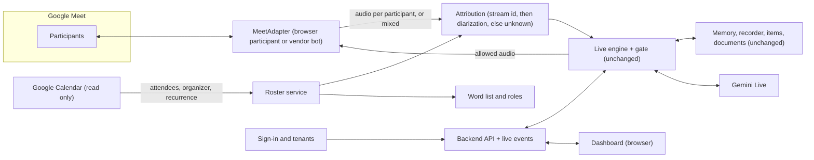

# Google Meet integration plan (Phase 2)

**Status: the foundation (M0 to M2, minimal) is built and tested against a local stand-in for Meet in a real Chrome; see [GOOGLE_MEET_BOT](GOOGLE_MEET_BOT.md). Nothing has run in a real Google Meet yet.** This page folds the remaining "bigger work" items into one plan: speaker identification (who said what), the Meet connection, the calendar roster, the dashboard, real users and teams, and meaning-based search. Everything Tara already does (memory, numbered meetings, open items, agenda, minutes, interviews, documents, spoken controls) lives in the application and is meant to carry over unchanged. The full command list with a "does it carry over" column is [COMMANDS](COMMANDS.md).

Background: [GOOGLE_MEET_RESEARCH](GOOGLE_MEET_RESEARCH.md) (options and their status as of 2026-10-19), [MEETING_PLATFORM_INTEGRATION](MEETING_PLATFORM_INTEGRATION.md) (adapter contract), [research/PHASE0_MEET_SPIKE](research/PHASE0_MEET_SPIKE.md).

## What does not change
The Live engine, the participation gate, playback cancellation, memory, the recorder, tools, documents and interviews all sit behind the `MeetingAdapter` interface. Today the adapters are the scripted local one and the microphone and speaker one. Google Meet becomes a third adapter. If the adapter honestly declares what it can do (`AdapterCapabilities`), the rest adapts: no per-participant audio means diarization and stricter interview gating; no platform mute means Tara stays silent in the application instead.

## What Meet must supply
| Need | Why | If missing |
|---|---|---|
| Two-way audio (hear the meeting, speak into it) | the whole product | no Meet support; stay on the local adapter |
| Per-participant audio or speaker labels | "who said what", action item owners, control-role checks, group interviews | everything is attributed to `unknown`; interview reports for individuals stay gated |
| A roster with names and who organizes | names for minutes and the word list; roles for permissions | Tara asks people to say their names; roles default to observer |
| Platform controls (mute, camera, picture, mute others) | the spoken controls that act on the platform | Tara says honestly that she cannot, and uses application silence |

## Architecture

## Phases and exit criteria
Each phase ends with a measured result, not a mock. A mock adapter proves nothing about Meet.

| Phase | Objective | Exit criterion |
|---|---|---|
| M0 | Re-check the options: Meet Media API status (was Developer Preview and closed), vendor bot APIs, terms of service, consent rules | **Done 2026-10-21:** Media API still Developer Preview and needs every participant enrolled, so a browser participant was chosen; sources in `research/SOURCES.md` (M4 to M6); vendor bot APIs were not evaluated |
| M1 | Audio spike in a test meeting you host: Tara joins, hears one other person, speaks back (browser participant with virtual audio devices, or a vendor bot) | **Partly done:** two-way audio proven in a real Chrome against a local stand-in (in-page bridge, no virtual device). **Still needed:** the same in a real Meet, with join time, delay and echo measured |
| M2 | `MeetAdapter` behind the existing interface, with honest `AdapterCapabilities`, join, leave, reconnect, and disconnect handling | **Built and tested offline and in local Chrome** (`src/tara/meet/`). **Still needed:** a real 30 minute meeting surviving one network drop |
| M3 | Who said what (item 16) | see below |
| M4 | Roster and calendar (item 17) | see below |
| M5 | Platform controls: probe and expose mute, camera, picture only if they work | each control either works in a real meeting or is reported unsupported |
| M6 | Real users and teams (item 20) | see below |
| M7 | Dashboard (item 19) | see [DASHBOARD](DASHBOARD.md) |
| M8 | Meaning-based search (item 18) | only after enough real meetings exist to build an evaluation set; see below |

### M3: Who said what (item 16)
Order of evidence, strongest first, matching [PARTICIPANT_IDENTITY](PARTICIPANT_IDENTITY.md):
1. **Per-participant audio stream** from the adapter (the stream id is the evidence). Best case; diarization is skipped.
2. **Platform speaker events** (active speaker) combined with timing, if streams are mixed.
3. **Diarization** of mixed audio ([SPEAKER_DIARIZATION](SPEAKER_DIARIZATION.md); a candidate is pyannote, not selected, real-time use unproven) giving anonymous labels, then mapped to roster names by what people say ("this is Sam").
4. **Otherwise `unknown`.** A wrong name is worse than none: individual interview reports and control commands stay gated on reliable identity.

The recorder then writes `Sam: ...` instead of `You: ...`, action items get real owners, and "who said that?" is answered from stored attribution or with "I am not sure". This also needs the transcript path to carry the speaker per turn (today the demo has one participant, "you").

### M4: Roster and calendar (item 17)
- Read-only calendar access (OAuth) to list today's meetings with attendees, organizer and recurrence. No writing to calendars in this phase.
- **Section mapping:** one section per recurring event series (so "the Monday stand-up" is one section of numbered meetings); ad-hoc meetings use the name you give.
- **Pre-fill:** attendee names go into the word list, the organizer becomes the `organizer` role, invitees become participants, and the meeting title sets the purpose and suggests a meeting type.
- `./dev.sh --calendar` lists upcoming meetings; `./dev.sh --meet <url>` starts one.
- Consent for calendar access, and what is read, is explicit and revocable.

### M6: Real users and teams (item 20)
Today every record belongs to tenant `local`, user `you`. For a team:
- **Sign-in** through the dashboard (provider chosen later); the authenticated identity sets the tenant and user. Scope never comes from model or user text; this rule already holds in the memory layer.
- **Tenants** isolate companies. **Users** own sections by default; a section can be shared with named people (read only or read and write).
- **Roles** (organizer, recruiter, participant, observer, candidate) come from the meeting roster, not from what someone says.
- **Data rights:** export and delete a section or all of a person's data; retention per tenant. The existing soft delete, retention and `purge_expired` are the base.
- Cross-tenant access tests with canary records are required before this ships (project rule).

### M8: Meaning-based search (item 18)
Recall today is PostgreSQL full-text search plus recency (ADR-0012, ADR-0015). Vectors (pgvector, ADR-0009) come only when real meetings show where keyword search fails, using an evaluation set built from them (`RAG_AND_MEMORY_EVALUATION`). The search interface (`MemoryStore`) already allows adding a vector leg without changing callers.

## Mapping of existing features to Meet
| Feature | What Meet adds or changes |
|---|---|
| Sections and numbered meetings | a calendar series becomes a section; each Meet session is the next meeting number |
| Recorder, summaries, retention | unchanged; transcripts now carry real speaker names |
| Open items, parking lot, opening brief | owners become real people; the brief can address the right people |
| Agenda and time nudges | nudges are spoken to the room; the gate waits while someone is mid-sentence |
| Recap and "what did I miss" | becomes valuable for late joiners |
| Names and jargon | seeded from the roster |
| Meeting types | suggested from the invite title; can be set by voice |
| Interviews | group interviews need reliable per-person identity (M3); candidates cannot silence her |
| Documents and minutes | unchanged; can be shared from the dashboard |
| Spoken controls | "Needs platform" rows depend on M5 |
| Errors spoken | if the Meet connection itself drops, Tara cannot speak; the dashboard and a chat message (if the platform allows) report it |

## Consent, safety and terms
- Disclose that an AI is present and recording at join (spoken, and in chat where possible), before any recording starts. Pause and stop commands must work.
- Unofficial browser participants may breach Meet's terms or break without notice; this is a risk to accept knowingly or avoid by using the official API or a vendor if one becomes available. The M0 decision records this.
- Audio and transcripts go to Google (Gemini). Paid tier is required for real interviews ([SECURITY_AND_PRIVACY](SECURITY_AND_PRIVACY.md)).
- Meeting content stays untrusted data: nothing said in a meeting can grant permissions.

## Risks and unknowns
- Whether the official Meet API allows sending audio is undocumented in what was read; vendor claims are unverified until M1.
- Echo and delay with a browser participant are unmeasured; speaker mode on a laptop already needs half-duplex.
- Real-time diarization quality and cost are unknown.
- Gemini Live tool calling, interruption and reconnect are still unverified even locally; they must be proven before depending on them in a meeting.
