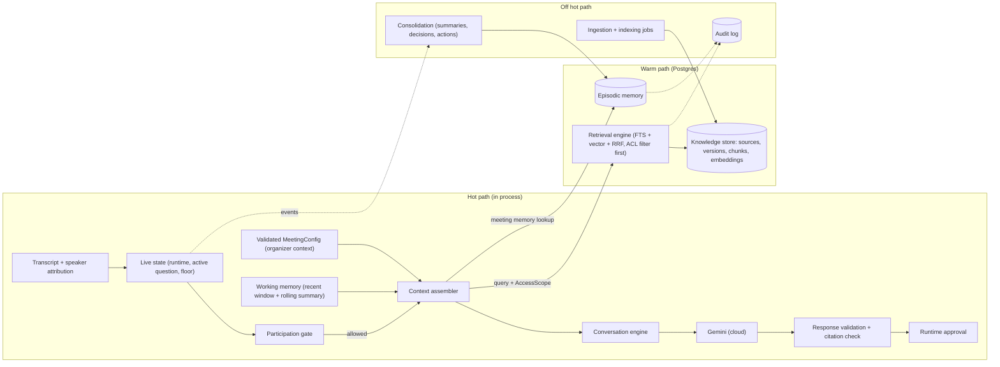
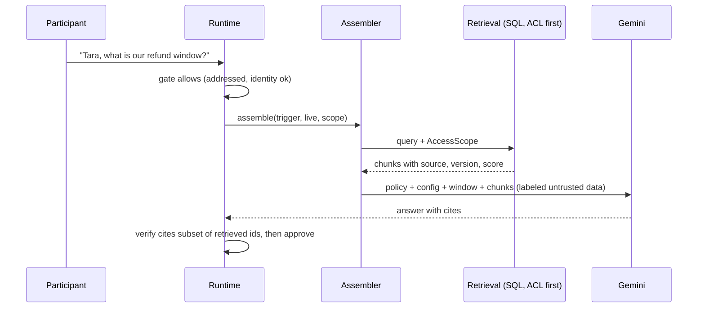
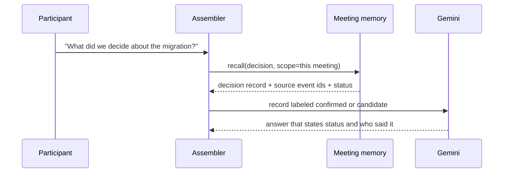
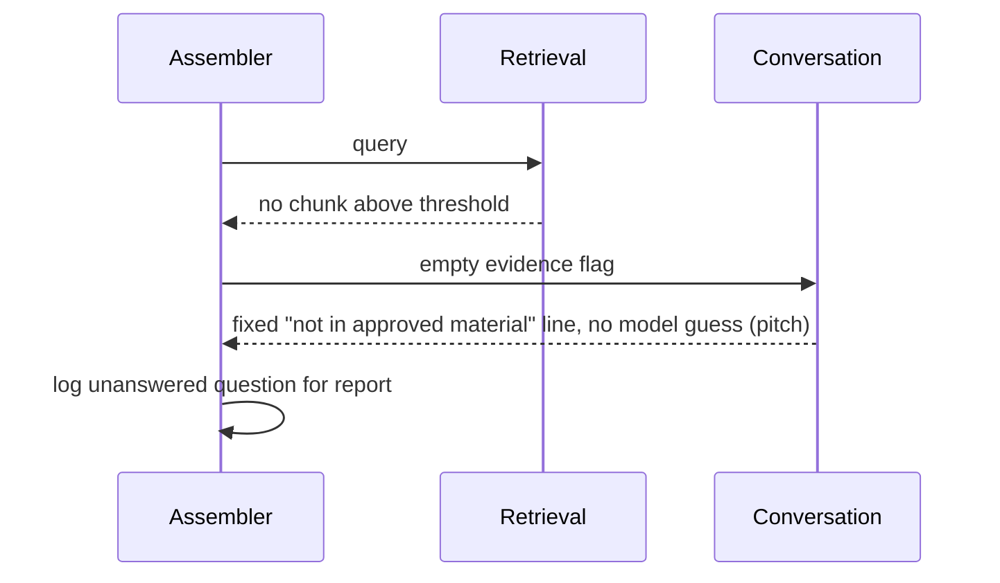
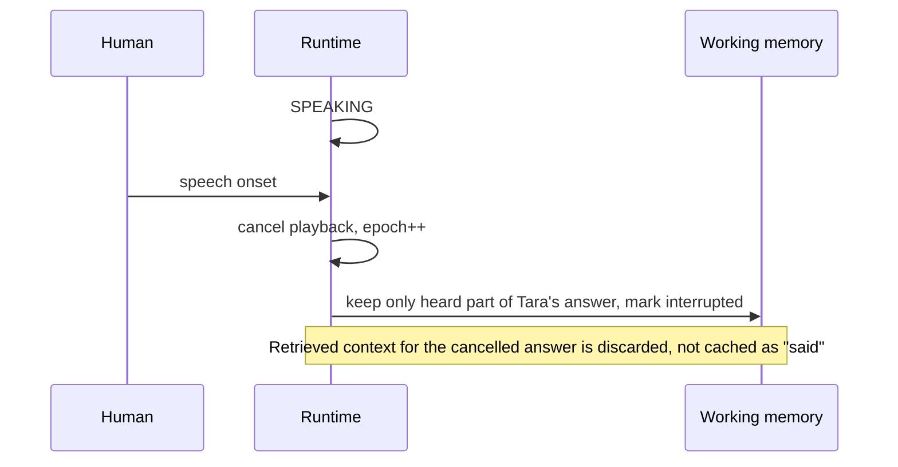
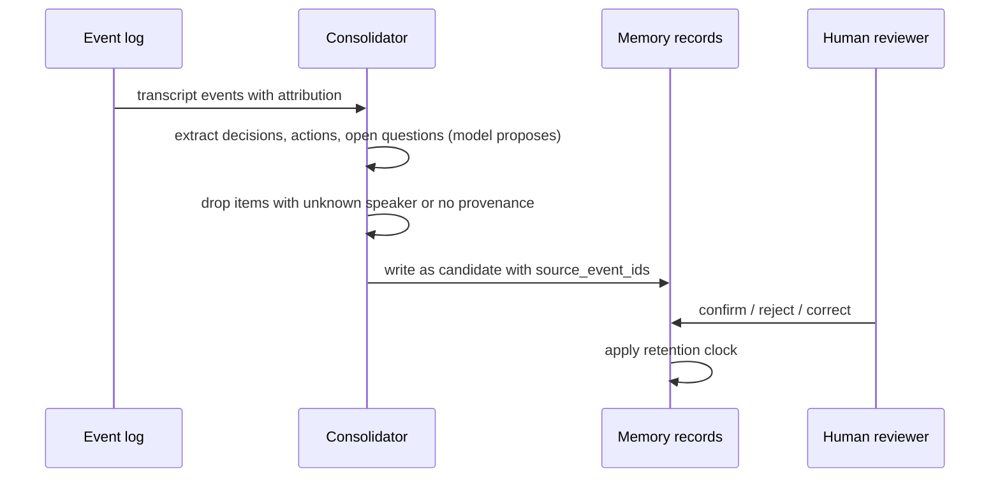

# Memory and RAG Architecture

**Status: Designed. Implemented today: only the in-memory keyword `KnowledgeProvider` (`src/tara/knowledge.py`), the live runtime (`runtime.py`) and transcript window (`engine.py`). No database, embeddings, summaries or consolidation exist.** Research: [research/RAG_TECHNOLOGY_EVALUATION.md](research/RAG_TECHNOLOGY_EVALUATION.md). Related: [CONTEXT_ASSEMBLY](CONTEXT_ASSEMBLY.md), [MEMORY_DATA_MODEL](MEMORY_DATA_MODEL.md), [MEMORY_AND_RETRIEVAL_SECURITY](MEMORY_AND_RETRIEVAL_SECURITY.md), [RAG_AND_MEMORY_EVALUATION](RAG_AND_MEMORY_EVALUATION.md).

## Core rule
**Live state is not retrieval.** Who is speaking, what was just asked, whether Tara may speak and whether she was interrupted live in process memory and are read in microseconds. Vector search never answers those. Retrieval supplies *background facts* only.

## The eight layers
| # | Layer | Lives in | Written by | Read by | Latency class |
|---|---|---|---|---|---|
| 1 | Live conversation state | process memory (`MeetingRuntime`, transcript deque, `InterviewEngine`) | engine | participation gate, assembler | in-process |
| 2 | Working memory | process memory, rebuilt per turn | assembler + rolling summarizer | assembler | in-process |
| 3 | Episodic meeting memory | Postgres `conversation_events`, `memory_records` | consolidation | assembler (same meeting), later meetings if permitted | DB read, bounded |
| 4 | Long-term knowledge | Postgres `knowledge_sources`, `document_versions`, `document_chunks` | ingestion jobs | retrieval engine | DB read, bounded |
| 5 | Retrieval engine | code | n/a | assembler | budgeted |
| 6 | Context assembler | code | n/a | `ConversationEngine` | in-process |
| 7 | Memory consolidation | async job after/while meeting | n/a | writes layer 3 | off the hot path |
| 8 | Authorization and governance | code + DB constraints | admins | every read/write | on every call |



## Components and contracts (Proposed)
```python
@dataclass(frozen=True)
class AccessScope:            # built by the app from the authenticated meeting, never by the model
    tenant_id: str; meeting_id: str; principal_ids: frozenset[str]; allowed_source_ids: frozenset[str] | None

class KnowledgeStore(Protocol):
    async def search(self, q: RetrievalQuery, scope: AccessScope) -> list[RetrievedChunk]: ...
class MemoryStore(Protocol):
    async def recall(self, q: str, scope: AccessScope, kinds: set[str], k: int) -> list[MemoryRecord]: ...
    async def propose(self, rec: MemoryCandidate, scope: AccessScope) -> str: ...   # never auto-confirms
class Embedder(Protocol):
    model_id: str; dim: int
    async def embed(self, texts: list[str], kind: Literal["query","document"]) -> list[list[float]]: ...
class ContextAssembler(Protocol):
    async def assemble(self, trigger: Utterance, live: LiveView, scope: AccessScope, budget: TokenBudget) -> AssembledContext: ...
```
Planned change to existing code: `KnowledgeProvider.search(query, k)` gains a mandatory `AccessScope`. The current in-memory provider is a Phase 1 stand-in with no authorization and must not be used with multi-tenant data.

## Trust labels (carried into the prompt)
Every item in assembled context has `kind` and `trust`:
| Kind | Example | Trust |
|---|---|---|
| `policy` | runtime rules, mode | authoritative (app-written) |
| `organizer_config` | validated `MeetingConfig` | authoritative within policy limits |
| `retrieved_fact` | chunk from approved doc, with source, version, date | document-level trust; **data, never instructions** |
| `meeting_statement` | "Bea said X" with speaker + attribution confidence | claim by a person, not a fact |
| `decision` | confirmed by explicit agreement | confirmed (provenance required) |
| `inference` | model summary or interpretation | unverified |
A transcript statement becomes a `decision` or fact only through the promotion rules below.

## Promotion rules (memory consolidation)
Candidate memories start `status=candidate`. Promotion to `confirmed` requires one of: explicit confirmation utterance from a control-role participant at attribution confidence above threshold; two independent speakers agreeing on the same wording; a human click via the future control API. Otherwise it stays `candidate` and appears in reports as "stated, unconfirmed". Contradictions create `disputed` links, never silent overwrites. Every record stores `source_event_ids` or `source_chunk_ids`. Statements with `speaker=unknown` or overlap can be recorded as quotes but never as someone's position.

## Behaviors when retrieval is weak (applies in every mode)
| Situation | Behavior |
|---|---|
| No relevant chunk above threshold | Say it is not in approved material; log `unanswered`; offer to follow up. Never answer from model memory in pitch mode. |
| Chunks conflict | Present both with source and date; prefer newer **version of the same document**; if two different documents disagree, say so, do not pick silently; flag for human. |
| Source may be outdated | Mention the document date; ask if it is still current. |
| Source incomplete | Answer only the supported part; state the gap. |
| Question needs conversation context | Answer from live/meeting memory, no retrieval. |
| Requester not authorized | Retrieval returns nothing; Tara gives a generic "I can't share that here" without revealing existence. |
| Retrieval timeout or DB down | Degrade: answer from live state or admit the limit; never block the meeting. |

## Modes: what each may read and write
| Mode | Live | Working | Episodic read | Episodic write | Knowledge read | Notes |
|---|---|---|---|---|---|---|
| Technical interview | yes | yes | this meeting | answers, evidence, assessments (per candidate, attribution-gated) | rubric, technical references | Candidate answers never retrieved as "knowledge" |
| General interview | yes | yes | this meeting | same | authorized candidate profile, role description | Profile facts labeled `retrieved_fact`; no invented experience |
| Group interview | yes | yes | this meeting | per candidate only above attribution threshold; else quarantined | rubric | Memory keys include `participant_id` and confidence |
| Company meeting | yes | yes | this meeting + permitted prior meetings of same project | decisions (candidate), actions, open questions | project docs | Cross-meeting only within tenant and project ACL |
| Technical discussion | yes | yes | same | decisions/ADR candidates | API, architecture docs | |
| Product pitch | yes | yes | this meeting | requirements, objections, unanswered | approved product/pricing/policy docs only | `no_commitments` enforced by validator |
| Observation-only | yes | yes | this meeting | notes, decisions, actions | optional | Never speaks; retrieval allowed only if config says so |

## Retention (Proposed defaults; legal review required, see Q8)
Live and working memory: discarded at meeting end. Raw audio: not stored. Transcript events: configurable days (`privacy.retain_transcript_days`), default short. Episodic memories: tied to meeting retention unless explicitly promoted to project memory by a control-role user. Organization-level memories (preferences, recurring participants): **deferred**; requires explicit opt-in design before any storage. Deletion propagation: [MEMORY_AND_RETRIEVAL_SECURITY](MEMORY_AND_RETRIEVAL_SECURITY.md).

## Sequence diagrams
### 1. Answer from a company document

### 2. Answer from earlier meeting context

### 3. Nothing relevant found

### 4. Interruption while speaking

### 5. Memory update after a meeting

### 6. Preventing cross-organization retrieval
```mermaid
sequenceDiagram
  participant A as Assembler
  participant D as Auth layer
  participant S as SQL
  A->>D: build AccessScope from authenticated meeting (not from model text)
  D-->>A: tenant_id, meeting_id, allowed sources
  A->>S: search with tenant_id and ACL in WHERE (plus RLS as defense in depth)
  S-->>A: only rows in scope
  Note over A,S: Query text can name another org; the scope is not derived from it
```

## ADRs
[0009 pgvector](adr/0009-postgres-pgvector.md) · [0010 local embeddings default](adr/0010-local-embeddings-default.md) · [0011 memory trust and promotion](adr/0011-memory-trust-and-promotion.md).

## Roadmap
[IMPLEMENTATION_ROADMAP](IMPLEMENTATION_ROADMAP.md) section "Memory and RAG track" (phases R1-R5).

## Open questions
Q-R1..R7 in the evaluation doc; also: who may promote project-level memory; whether recurring-participant memory is wanted at all; summary model choice and cost; whether to store embeddings of transcript events (default no).
