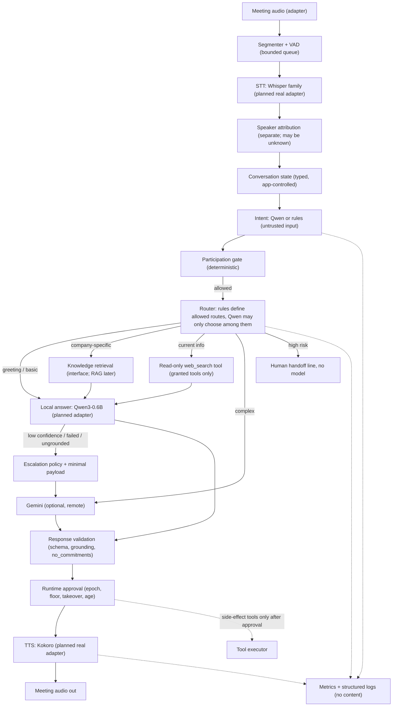
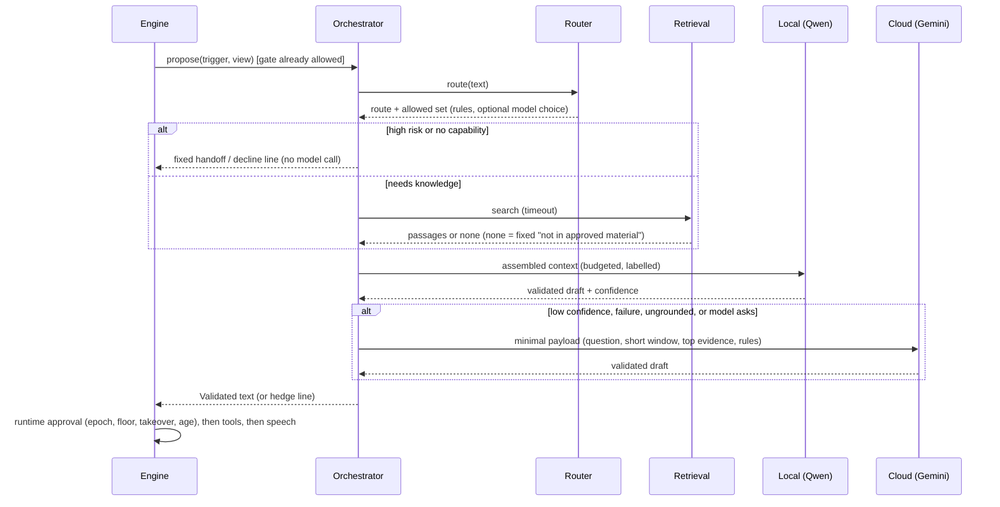

# Unified Runtime Foundation

> **Superseded 2026-10-20 as the primary path.** Gemini Live is now the voice engine ([GEMINI_LIVE](GEMINI_LIVE.md)). This document describes the optional, dormant local-model path: nothing here is downloaded, installed or started. The runtime pieces (settings, lifecycle, routing, state, metrics) remain implemented and tested; the Qwen, Whisper and Kokoro adapters are kept for optional offline use later.

**Status: Implemented against fakes (219 offline tests, `mypy src` clean, `ruff` clean). Not run with any real model, Gemini key or meeting.** Written 2026-10-20. Companion to [SYSTEM_ARCHITECTURE](SYSTEM_ARCHITECTURE.md) (conceptual), [MEETING_RUNTIME](MEETING_RUNTIME.md) (floor state machine) and [MEMORY_AND_RAG](MEMORY_AND_RAG.md) (designed retrieval).

## What this adds, and what it deliberately keeps
The repo already had the meeting state machine, participation gate, engine, tools, Gemini client and fakes. This phase did **not** replace them. It added what the "one coordinated system, not three scripts" goal needs: a settings layer, model lifecycle and inference control, typed conversation state, request routing with escalation, a context assembler, a response orchestrator, observability, and a composition root. The models are coordinated through interfaces; **no weights are merged or trained.**

## Runtime architecture

Same shape as the brief's conceptual diagram. It is one process; local inference runs in threads behind bounded pools, not in separate services.

## Model responsibilities
| Model | Does | Does not | Real adapter |
|---|---|---|---|
| Whisper (mlx-whisper) | Segment transcription with timestamps | Speaker identity, streaming partials | written, **untested, nothing downloaded** |
| Qwen3-0.6B (mlx-lm) | Short local replies, intent hints, route choice among allowed routes, structured extraction | Floor, permissions, tool grants, protected retrieval, anything "critical" | written (`providers/qwen_local.py`), **untested, nothing downloaded** |
| Kokoro-82M | Sentence-chunked TTS, cancellable between segments | Decide what to say | written, **untested** |
| Gemini (optional) | Complex or uncertain answers via `generateContent` | Receive anything not in the minimal payload; run for every request | written, tested with a fake transport only |

Qwen safety boundary (tested): rules compute the `allowed` route set; a model choice outside it is discarded; high-risk topics have a single allowed route (handoff) so the model is never even asked; the model's JSON must validate; a model failure falls back to rules. Qwen intent output feeds a deterministic gate that also requires trusted role and attribution confidence for control intents.

## Interfaces (`contracts.py`, `models.py`, `routing.py`, `respond.py`)
`SpeechRecognizer`, `LanguageModelProvider`, `SpeechSynthesizer`, `KnowledgeProvider`, `MeetingAdapter` (typed Protocols); `ToolExecutor` + `ToolDef`; `ConversationState`; `ContextAssembler`; `Responder`. Cross-cutting: typed errors (`errors.py`: `ProviderTimeout`, `MalformedOutput`, `ModelLoadError`, `QueueFull`, `BudgetExceeded`, ...), `Health` + `health()`/`close()` on the real adapters, timeouts in `LimitSettings`, cancellation via task cancel, metrics in `Metrics`. No plugin framework.

## Request lifecycle

Interruption: engine cancels the response task, bumps the epoch, drops stale work, and truncates history to what was heard (unchanged from [MEETING_RUNTIME](MEETING_RUNTIME.md)). Obsolete generations are rejected by the epoch check and by per-chunk checks during playback.

## Routing rules (first version, `routing.py`)
| Input | Allowed routes | Default |
|---|---|---|
| high-risk words (discount, contract, refund, salary, hire, password...) | human handoff only | handoff |
| greeting / thanks | local | local |
| current information (today, latest, news...) | web search if the tool is granted, else decline | web search / decline |
| company-specific or knowledge-bound mode (pitch) | local+retrieval, cloud+retrieval if cloud allowed; decline if retrieval is unavailable | local+retrieval |
| complex technical (keywords or long) | local, cloud if available | cloud when available |
| otherwise | local, cloud if available | local |
Keyword lists are a starting point and will misroute; they are covered by tests for intent, not for accuracy. Escalation triggers: local failure/timeout/malformed, confidence below `escalate_below_confidence`, ungrounded in a retrieval route, explicit model request. Never escalated: handoff, decline, web search. No cloud (Gemini off, key missing, or meeting privacy `send_transcript_to_llm` false): low-confidence local answers become an honest hedge line instead of being spoken.

## Conversation state (`state.py`)
Typed fields: meeting id, mode, organizer instructions, topic, summary, bounded recent utterances with speaker id and confidence, active question, response task (stage, route, epoch), pending tool calls, `tara_speaking`, `interrupted`, `user_has_control`, retrieved context (per question, separate from flags). Changed only by events through `apply()`. Model-sourced events may suggest a topic or summary (length-limited) and can never touch critical fields (tested). `to_persistable()` returns only meeting id, mode, topic, summary; flags, tasks, tool calls and raw retrieved passages are transient. The engine keeps it in sync with the runtime and tests assert the invariants (`tara_speaking` equals runtime SPEAKING; `user_has_control` equals takeover). No long-term memory exists ([MEMORY_AND_RAG](MEMORY_AND_RAG.md) is design only).

## Model lifecycle and resources (`models.py`)
`ModelHandle`: lazy, single instance, one shared load under concurrency, structured failure with a retry cooldown, load timeout, unload, close. `InferencePool`: bounded concurrency and bounded wait queue (overflow raises `QueueFull`, never buffers), timeouts, cancellation. A thread cannot be killed: on timeout or cancel the result is discarded but the slot is held until the thread ends, so concurrency stays bounded (tested). `ModelManager`: duplicate registration refused, `warm_up` returns failures instead of raising, `unload_idle`, shutdown in reverse order collecting errors. Failure degrades: a model that fails to load makes the response a hedge line; the meeting keeps listening (tested).

Trade-off (no measurements yet, so no claim): keeping all models loaded minimizes first-response latency and costs memory shared across STT, LLM and TTS; on-demand loading saves memory but adds load time to the first request after idle. Defaults: lazy first load, keep loaded (`TARA_KEEP_MODELS_LOADED`), idle unload available (`TARA_IDLE_UNLOAD_S`). Decide with Phase 2 numbers.

## Tools (`tools.py`)
Each `ToolDef`: unique name, description, typed required/optional args, timeout, permission label, `side_effect` flag. Granted only if requested by the validated config AND allowed by app policy; model proposals are validated (unknown/missing/mistyped args refused). Read-only tools may run during generation (`execute_read_only`); side-effecting tools run only after runtime approval and, if configured, human approval. Every call is audited with ids and outcome, never argument values. Output is marked untrusted and wrapped in the prompt. `web_search` is an interface only; `NotConfiguredSearch` fails rather than inventing results.

## Context assembly (`context_assembly.py`)
Budgets come from settings (`TARA_LOCAL_CONTEXT_TOKENS`, `TARA_CLOUD_CONTEXT_TOKENS`; the cloud value must be set by the operator because the fetched Gemini page did not state Flash limits). Token counts are `len/4` estimates until a real counter is verified. Trim order: oldest history, lowest-ranked evidence, summary; system rules and the question are never trimmed and `BudgetExceeded` is raised if they alone do not fit. Evidence is deduplicated, wrapped in labelled untrusted tags, and delimiter look-alikes are stripped.

## Configuration (`settings.py`, `.env.example`)
One typed `RuntimeSettings` from environment variables: models and paths, inference (Qwen non-thinking sampling values from its model card; not yet applied by the adapter, see unverified), limits and timeouts, Gemini (`enabled`, key, model), behavior (lazy load, keep loaded, idle unload, escalation threshold, log level, 30-minute meeting target). `validate()` rejects: missing Gemini key/model/context size when enabled, unknown backends, non-positive limits, missing local model **paths** (`check_files`, repo ids are never treated as paths). The key never appears in `repr`, `redacted()`, or error text (tested).

## Error handling
| Failure | Behavior |
|---|---|
| Model load failure | `ModelLoadError`, handle FAILED with cooldown, health shows it, response falls back to hedge/escalation |
| Inference timeout / queue full | typed error, counted, escalate if allowed else hedge |
| Malformed model JSON | one bounded retry, then `MalformedOutput`, then escalate/hedge |
| Retrieval slow or down | fixed "can't verify right now" line, never a guess |
| Tool timeout / error / denied | reported with a code, audited, never retried automatically |
| Cloud missing or vetoed by meeting privacy | no cloud call; hedge instead of a shaky answer |
| Unexpected exception in a response task | boundary catches, emits event, returns to LISTENING |
| Invalid state change | rejected, counted (`state_invalid`), meeting continues |

## Observability (`metrics.py`)
Counters, gauges, bounded histograms with p50/p95/max. Stages: `audio_ms`, `stt_ms`, `classify_ms`, `route_ms`, `retrieval_ms`, `local_llm_ms`, `cloud_llm_ms`, `tts_first_chunk_ms`, `queue_wait_ms`, `model_load_ms`, `response_total_ms` (utterance handling start to playback start; excludes VAD and STT, which have their own metrics). Counters include routes, escalations by reason, inference failures, cancellations, interruptions, takeovers, tool denials and failures. Gauges: active tasks, queue depth. Logs are structured JSON with content-bearing fields replaced by their length. Resource usage (RSS) is not collected yet. **No latency claim is made: nothing has been measured.**

## Testing
219 offline tests, no downloads or credentials: settings and secrets, lifecycle (single load, failure, cooldown, timeout, idle unload, shutdown order), pool bounds/queue/timeout/cancel, Qwen adapter with a fake generator (think-stripping, JSON repair retry, load failure, timeout), state invariants, routing and escalation, context budget and trimming, tools (validation, timeout, read-only gate), orchestrator scenarios (greeting, complex, grounded, no evidence, retrieval timeout, escalation, double failure, injection, handoff, web search), composition root (invalid settings, privacy veto, missing model degradation, clean shutdown), engine integration (state mirrors runtime through takeover and barge-in; stale and failed responses leave state clean). Run: `.venv/bin/python -m pytest -q`, `.venv/bin/ruff check src tests`, `.venv/bin/mypy src`.

## Local development on Apple Silicon (proposed; nothing downloaded)
Python 3.11+, `.venv`. **Cancelled 2026-10-20:** the plan to install `mlx-lm`, `mlx-whisper`, `kokoro` and `espeak-ng` and download models was removed when Gemini Live became the primary engine. See [LOCAL_DEVELOPMENT](LOCAL_DEVELOPMENT.md) and [GEMINI_LIVE](GEMINI_LIVE.md).

## Research (2026-10-20; see [research/SOURCES.md](research/SOURCES.md))
Qwen3-0.6B: Apache-2.0, 0.6B params, 32,768 context, thinking on by default (switch off with `enable_thinking=False`), listed as runnable with MLX-LM and llama.cpp; non-thinking sampling temperature 0.7, top_p 0.8, top_k 20. mlx-lm: MIT, `load`/`generate`/`stream_generate`, Apple silicon. `mlx-community/Qwen3-0.6B-4bit`: 351 MB repo (model.safetensors 335 MB). The mlx-lm README did not mention Qwen3 specifically, so support is **unverified until loaded**.

## Unverified / open
Whether the mlx tokenizer passes `enable_thinking` to the chat template (fallback `/no_think` coded); the mlx-lm sampler API (`make_sampler` import is attempted and ignored on failure); Gemini auth header and `responseSchema` casing against a live call; real Qwen quality on intent, routing and short answers (it may need rules to cover more); latency of every stage; whether 0.6B is good enough for the confidence it self-reports (self-reported confidence from a small model may be poorly calibrated: treat it as one signal, measure); Silero/WebRTC VAD choice. See [research/OPEN_QUESTIONS.md](research/OPEN_QUESTIONS.md).

## Differences from the request
The brief calls this "Phase 0"; in this repo Phase 0/1 were already done, so this is a foundation increment on top of them and Phase 2 (real models) is unchanged and not started. The brief's diagram had Qwen classify before state; here an intent hint (Qwen or rules) feeds the deterministic gate first, then routing, so a small model never decides whether Tara may speak. Retrieval, RAG ingestion, Meet, diarization and the avatar are untouched.
