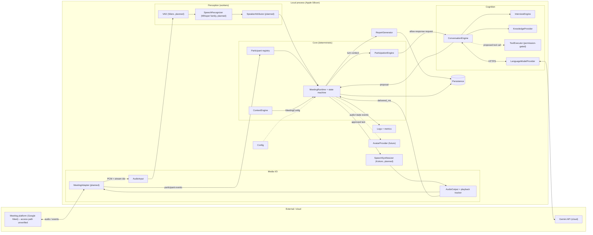

# System Architecture

> **2026-10-20:** the diagram below is the original conceptual (cascaded) design. The implemented primary voice path is Gemini Live behind provider interfaces: see [GEMINI_LIVE](../engine/GEMINI_LIVE.md) for the architecture as built.

**Status: Proposed (Designed, not implemented).** Single Python process (modular monolith) with async I/O and a small worker pool for CPU-bound inference. No microservices ([ADR-0001](../adr/0001-modular-monolith.md)).

Solid = data flow; dotted = control/optional. Labeled planned/future components do not exist yet.

## Layers and rules
1. **Media I/O** knows platforms and codecs; knows nothing about meetings' semantics.
2. **Perception** turns audio into timestamped, attributed utterances.
3. **Core** is pure-ish deterministic logic: state, policy, identity, permissions. Fully unit-testable without models.
4. **Cognition** proposes; it never speaks, never executes.
5. **Runtime** is the only component allowed to start playback or run a tool.

## Concurrency model
- One asyncio event loop for I/O, timers, provider calls, WebSocket.
- STT/TTS/diarization inference in worker threads/processes with bounded queues (async here would not help CPU-bound work; see [REAL_TIME_ARCHITECTURE_RESEARCH.md](REAL_TIME_ARCHITECTURE_RESEARCH.md)).
- Every in-flight generation is a cancellable task tagged with `epoch` and `utterance_id`.

## Hybrid consequences
Gemini needs internet; transcripts (and any audio sent) leave the machine; local inference competes for 24 GB unified memory and thermal budget; API key must be protected. See [SECURITY_AND_PRIVACY.md](SECURITY_AND_PRIVACY.md).

## Runtime foundation
Routing, escalation, typed state, model lifecycle, tools and metrics as implemented are in [RUNTIME_FOUNDATION](../engine/RUNTIME_FOUNDATION.md); that document is authoritative where it differs from the conceptual diagram above.

## Memory and retrieval
Live state, working memory, episodic meeting memory, a Postgres+pgvector knowledge store, retrieval, context assembly and consolidation are specified in [MEMORY_AND_RAG](../memory/MEMORY_AND_RAG.md). In the diagram above "KnowledgeProvider" and "Persistence" stand for that design; only an in-memory keyword provider exists today.

## Implemented vs documented
Nothing in the repository is implemented. This file describes intent.
