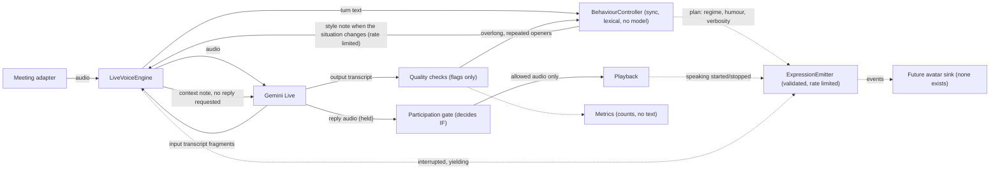

# Conversational Behaviour System

**Status: behaviour logic implemented and tested offline (see the newest changelog entry). How it sounds is NOT verified: one real smoke turn produced audio, but no behaviour scenario has been run and nobody listened to it; no vocal expression (laughter, tone, pacing) is verified.** Written 2026-10-21. Sources and access dates: [research/SOURCES.md](../research/SOURCES.md) (B1-B3). Parent: [GEMINI_LIVE](../engine/GEMINI_LIVE.md). Spoken actions are documented separately in [MEETING_CONTROLS](../meetings/MEETING_CONTROLS.md).
**Status: behaviour logic implemented and tested offline (see the newest changelog entry). How it sounds is NOT verified: one real smoke turn produced audio, but no behaviour scenario has been run and nobody listened to it; no vocal expression (laughter, tone, pacing) is verified.** Written 2026-10-21. Sources and access dates: [research/SOURCES.md](../research/SOURCES.md) (B1-B3). Parent: [GEMINI_LIVE](../engine/GEMINI_LIVE.md). Spoken actions are documented separately in [MEETING_CONTROLS](../meetings/MEETING_CONTROLS.md).

## The principle
Three things stay separate:
1. **Participation** (may Tara be heard at all?) is decided by the deterministic gate in `voice/participation.py`. Personality can never override it.
2. **Conversational intent and style** (what Tara is trying to do and how restrained, brief or warm it should be) is this system.
3. **Vocal and visual expression** (how it sounds, what a future avatar shows) are downstream and mostly outside our control.

`BehaviourController` has no reference to the gate, no permission field in its plan, and no `await` (tested). It cannot make Tara speak, stay quiet, or ignore an interruption, a mute or a takeover.

## What the Live model actually lets us control (verified from docs, 2026-10-20/21)
| Lever | Supported on `gemini-3.8-live`? | How we use it |
|---|---|---|
| System instruction (personality, style rules) | Yes | Persona text built per profile (`behaviour/persona.py`), set once at session start |
| Voice selection | Yes (30 prebuilt voices listed on the speech page; Live says any TTS voice) | `TARA_LIVE_VOICE`; we pick no voice for you |
| Mid-session context (`send_client_content`, `turn_complete=false`) | Yes, "throughout the entire session" per the model page; `turn_complete=true` interrupts generation, so we never set it | Short style notes when the mood changes |
| Proactive audio (model may decline irrelevant input) | **Always on**; setting it false returns an error | We never send a value; useful against background noise, but our gate still decides |
| Affective dialogue (emotion-adaptive replies) | **Removed** on 3.8 Live | Not used; `enable_affective_dialog` is never set |
| Thinking level | Not supported on 3.8 Live (omit) | Not set |
| Laughter, sighs, other non-verbal sounds | **Not documented for Live.** The `<laugh>`, `<sigh>` style tags are documented for the separate TTS models only, and that page does not say they apply to Live | Not used. No tags are sent. `vocal_reactions` only permits brief reactions in ordinary spoken words |
| Tone, pacing, accent controls | **Not documented for Live** (style fields exist for TTS) | Only indirect, through the persona text; effect unverified |
| Languages | 99, switches naturally, language code cannot be set | English-only heuristics in our checks and signals |
| Async tool calls | Default NON_BLOCKING on 3.8 Live | `TARA_LIVE_TOOL_BEHAVIOR` (default leaves the provider default) |
Consequence: expressiveness is mostly the model's own native-audio behaviour steered by instruction text. We do not claim more.

## Architecture

Solid = affects the session; dotted = observation or future consumer. The persona text is set once in the system instruction; the controller only adds short notes when the mood, length or repetition situation changes.

## Components (`src/tara/behaviour/`)
- **profiles.py**: `professional` (default for meetings), `conversational`, `expressive`. They set ceilings for humour (restrained, light, playful), expressiveness, default verbosity, formality and laughter cooldowns. They change style limits, not character, and carry no permissions. Interviews are always clamped to `professional`.
- **signals.py**: deterministic English lexical cues in participants' speech: laughter, joking, frustration, bad news, confusion, correction, urgency, conflict, sensitive topics, unexpected news, request for detail or brevity, question, addressed by name, formality. Heuristic: expect false positives and negatives; it steers style only.
- **controller.py**: `observe(text, final)` returns a `BehaviourPlan` (intent, tone, expressiveness, humour, laughter, verbosity, formality, regime, reasons). Rules:
  - Regime precedence: sensitive, then serious (urgent or conflict), then empathy (frustration or bad news), then playful, then neutral. Serious moods persist for several turns so a joke right after an incident is not allowed; sensitive ones last longer.
  - Humour requires a playful room, never in interviews, yielding, mute, or heavy regimes. A brief reaction is only suggested when a participant made the joke, and only if the laughter cooldown (time and turns) has passed and the allowance is spent only when Tara actually speaks.
  - Verbosity starts at the profile default; urgency, a request for brevity, a recent interruption, or feedback from an overlong answer moves it down; an explicit request for detail moves it up.
  - Intent: stay back (yielding), accept correction, clarify simply, empathize then help, react lightly, answer, acknowledge briefly.
  - `guidance()` renders a short note from enumerated fields (never participants' words, so nothing leaks), only when the regime, verbosity, expressiveness or an overused opener changes; rate limited except when entering a serious or sensitive moment.
- **checks.py**: flags in Tara's own words from output transcription: stock openers, AI disclaimers, human-experience claims, unprompted or exaggerated laughter, spoken numbered lists, stage directions, restating the question, overlong answers, repeated openers. Counted as metrics (names only). They never edit or block speech.
- **expressions.py**: avatar-ready events `speaking_started`, `speaking_stopped`, `listening`, `thinking`, `amused`, `surprised`, `concerned`, `interrupted`, `yielding_control`. Validated schema (emotional events must be `basis=context`, state events `basis=runtime`), consecutive duplicates dropped, emotions rate limited, sink failures isolated. Emotional events are emitted only when Tara starts speaking and the context supports them (a joke with humour allowed, bad news or urgency, an unexpected-news cue in a non-serious moment). **They describe context-supported stance, not what the audio contained.**
- **meeting_kind.py**: `MeetingKindTracker` infers `casual`, `technical`, `interview`, `client`, `incident` or `brainstorm` from the meeting mode, an explicit override and sustained lexical evidence. It returns no kind when evidence is weak. The controller uses the kind only to restrict style, never to grant or deny speech.
- **persona.py**: the system-instruction text: personality, natural speech rules, avoid-list described as principles (not scripted lines), reaction guidance, humour limits, honesty about being an AI, listening, and the statement that style never overrides meeting rules.

## Meeting kinds

A kind is a style hint. It can lower humour, formalise the tone, simplify vocabulary or relax the need for a playful cue; it can never raise humour above the profile's ceiling, and it has no permission or participation path.

| Kind | Effect on style |
|---|---|
| `interview` | Always used for the three interview modes, whatever the conversation says. Professional, formal, no humour. |
| `incident` | Set by an urgent signal and held for a few turns. Serious regime, no humour, calm and direct. |
| `technical` | Precise, trade-offs, plain language; humour capped at restrained. |
| `client` | Client-facing, formal, careful claims; humour capped at restrained. |
| `brainstorm` | Ideas are welcome and may be labelled as ideas; the need for a playful cue is relaxed to light humour, but laughter still requires a participant joke. |
| `casual` | Light, informal, still inside the profile's ceilings. |

Inference is English-only and deliberately conservative:

- An explicit `meeting_kind` in the meeting config wins.
- Interview modes are always `interview`, with no inference.
- An urgent signal forces `incident` for three turns.
- A kind needs a clear lexical lead over the runner-up (margin) and at least two consecutive leads before it switches (hysteresis).
- After a switch, a cooldown blocks another switch for several turns, so one sentence cannot flip the style back and forth.
- With no evidence the kind is empty (`""`): casual is never assumed, and the default neutral style is used.
- A profile ceiling still wins: for example, `professional` stays at restrained humour even in `casual`, and `brainstorm` cannot lift it to light.
- The kind text is included in the internal style note, so the model is told what kind of meeting it is. That note is never spoken.

## Timing
No artificial delay is added anywhere. The behaviour layer runs inline on transcript fragments in milliseconds (bounded in a test), makes no model call, and is measured as `behaviour_ms`. Natural timing comes from the live model's own turn-taking plus our rules: response audio is held until the gate decides; allowed speech **waits (bounded) while another participant is mid-sentence** rather than talking over them, and drops if the moment passes (`TARA_PERSONA_FLOOR_WAIT_MS`); playback stops immediately on interruption; Tara does not retry after a takeover. The hold and the floor wait can add latency by design; both are measured via existing metrics and tunable.

## How the layer reaches Gemini Live
1. **Session start:** system instruction = meeting rules + persona for the effective profile.
2. **During the session:** as transcript fragments arrive, the controller updates; when the situation changes it emits a one-line note via `send_client_content` with `turn_complete=false`. The note says it is internal and must not be spoken or answered. If the model ever spoke in response, the participation gate would have no addressed transcript and would deny it (fail silent). Effect on the real model is **unverified**: an opt-in live test checks that a note triggers no spoken reply.
3. **After each reply:** checks run on the output transcript; overlong or repetitive replies feed back as brevity or variation notes.
4. **Reconnect on a fresh session:** the last note is sent again.

## Configuration
| Setting | Meaning | Default |
|---|---|---|
| `TARA_PERSONA_PROFILE` | `professional`, `conversational` or `expressive` for the process | `professional` |
| meeting config `behaviour_profile` (also accepted from the organizer draft) | per-meeting request; overrides the process default; validated; interviews ignore it (warning) | empty |
| meeting config `meeting_kind` | explicit style override: `casual`, `technical`, `interview`, `client`, `incident` or `brainstorm`; empty means infer | empty |
| `TARA_PERSONA_GUIDANCE` | send mid-session style notes | on |
| `TARA_PERSONA_GUIDANCE_INTERVAL_S` | minimum seconds between notes (serious moments bypass it) | 15 |
| `TARA_PERSONA_VOCAL_REACTIONS` | allow brief spoken amusement in ordinary words (non-verbal laughter is not claimed) | off |
| `TARA_PERSONA_FLOOR_WAIT_MS` | how long allowed speech waits for someone mid-sentence | 2500 |
| `TARA_LIVE_VOICE` | prebuilt voice name | provider default |
| `TARA_LIVE_TOOL_BEHAVIOR` | `default`, `blocking`, `non_blocking` | `default` |
Profile choice is style; permissions come from the meeting config and the gate.

## Testing (what the offline suite establishes and what it does not)
Deterministic tests cover all twelve requested scenarios (funny remark, disappointing news, correction, interruption, direct technical question, discussion not involving Tara, disagreement guidance, missing information, serious meeting, informal meeting, explicit quiet request, repeated context without canned reactions), plus: laughter cooldown and no machine-gunning, serious moods persisting, interviews clamped, guidance content leaking no participant words, guidance rate limiting and bypass, expression schema and rate limits, sink isolation, checks on good and bad sample replies, profile selection and clamping, config validation, no permission field or gate reference, no await or sleep in the controller, behaviour overhead bounded, no extra model calls, and engine-level proof that jokes or an expressive profile never make Tara speak when not addressed, that mute, silent policy, takeover and interruption still win, and that Tara does not talk over a participant. Meeting-kind tests cover override precedence, interview modes, incident, hysteresis, margin, cooldown, no assumed casual, brainstorm relaxation without laughter, guidance text and profile ceilings (`tests/behaviour/test_meeting_kind.py`). Notes tests cover the notes-active gate, candidate provenance, explicit promotion, summary separation and refusal of a non-control speaker (`tests/control/test_notes_control.py`). Floor-wait tests found and fixed a real bug: a response that completed while a participant was speaking was being dropped.

What they do **not** establish: that the model sounds natural, laughs, varies tone, avoids stock phrases, disagrees well, admits uncertainty, or avoids human-experience claims. Disagreement, uncertainty and honesty are enforced only by instruction text plus after-the-fact flagging. The opt-in evaluation (`tests/live/test_behaviour_live.py`) measures canned-opener and length rates and rubric flags from transcripts over six scenarios, and checks that a style note triggers no reply. It cannot hear laughter or tone: a human must listen. One real smoke call returned 80,160 bytes at 24 kHz from a single text turn, but it was not evaluated for style or vocal quality.

## Not implemented / future
Real-session verification of everything vocal; an avatar (events only); LLM-based or multilingual signal detection; detecting that Tara is being addressed without her name beyond the existing conservative classifier; adaptive per-participant formality memory; using the measured vocal capabilities once confirmed (for example any documented Live nonverbal control).
Open questions: [research/OPEN_QUESTIONS.md](../research/OPEN_QUESTIONS.md) (Q-B1..Q-B7).
