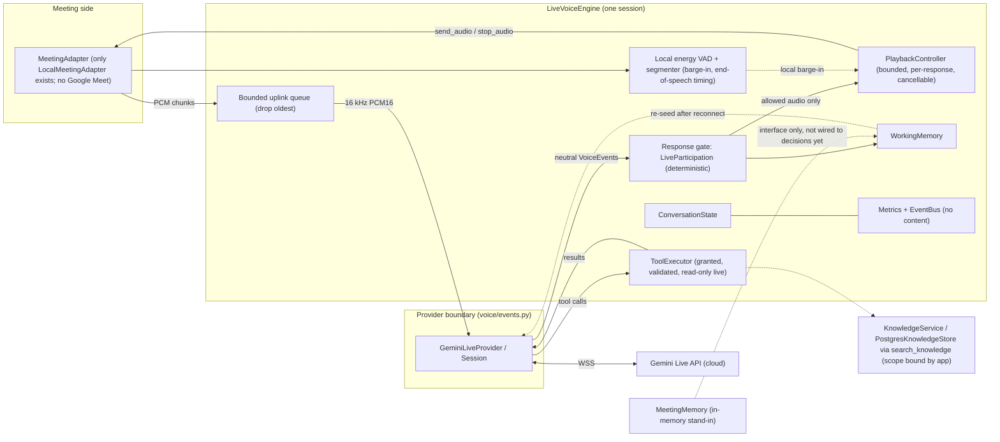
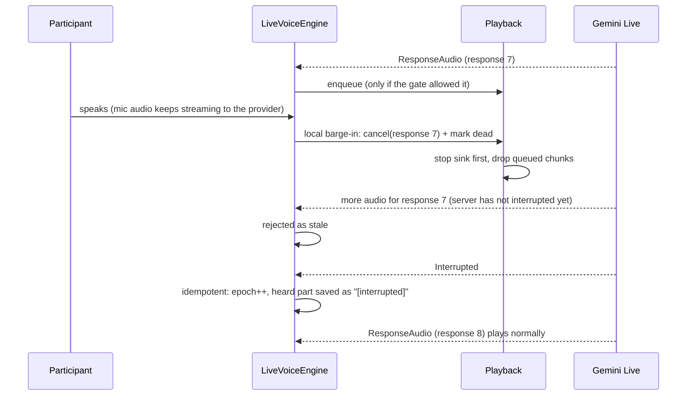

# Gemini Live: the primary voice engine

**Status: implemented against scripted fakes and the real SDK's types (see the newest changelog entry for the current offline count). One real one-turn smoke test has run (2026-10-20): 1771.9 ms connect, 1039.4 ms to first audio, 80,160 bytes at 24 kHz, turn complete. That verifies connection, output audio, sample rate and text-to-first-audio latency only. A local microphone/speaker demo adapter and CLI are implemented, fake-backend tested, and the owner has run the headphone conversation on real hardware (microphone capture, gate, model audio, playback). Persistent memory v1 (PostgreSQL explicit save/recall/forget plus a bounded startup block) is implemented and tested against real PostgreSQL, and read-only orchestration tools are registered through the same function-calling path (Open-Meteo and countries.dev checked live; web search providers not). How the live Gemini model calls any of these tools is unverified. Speaker echo, real event ordering under interruption, tool behavior, behaviour/humour and speech-to-speech latency remain unverified.** Written 2026-10-20, updated 2026-10-21. Sources and access dates: [research/SOURCES.md](../research/SOURCES.md) (L1-L8).

## Decision
Tara's primary real-time voice path is Gemini Live (speech in, speech out, transcription, tool calls, interruption) behind our own interfaces. **No local model is downloaded, installed or loaded.** The earlier cascaded plan (Whisper, Qwen3-0.6B, Kokoro) is demoted to optional, dormant code: the adapters and the routing runtime still exist and are tested with fakes, but nothing starts them, and `docs/PHASE2_SETUP_PLAN.md` (the download plan) was removed. Local models can return later for offline use, cost, or privacy-sensitive processing without changing the voice interfaces. See [ADR-0013](../adr/0013-gemini-live-primary.md).

## What the existing repository had (inspected first)
A deterministic core (config validator, meeting state machine, participation gate, tools, identity, evidence, reports), a cascaded async engine (`legacy/engine.py`), a unified-runtime foundation (settings, model lifecycle, routing, state, metrics), memory/RAG design docs, and a `MeetingAdapter` contract with only a scripted `LocalMeetingAdapter`. There was no Google Meet connection and no real audio device adapter; a local mic/speaker demo adapter now exists and is fake-backend tested.

## Short implementation plan (as executed)
1. Verify the Live API from official docs and by inspecting the installed `google-genai` 2.31.0 SDK locally (no network).
2. Neutral contracts (`voice/events.py`) so no Google type leaks past one file.
3. Adapter (`voice/gemini_live.py`), playback with cancellation (`voice/playback.py`), participation gate (`voice/participation.py`), engine (`voice/engine.py`), memory interfaces (`voice/memory.py`), composition (`voice/app.py`), opt-in smoke test.
4. Reuse the existing tools, state, metrics, settings, adapter contract; refactor shared participation helpers instead of duplicating them.
5. Add a local microphone/speaker `MeetingAdapter` and `tara.voice.demo` for real-device testing; it stays outside Meet and keeps the same gate.

## Verified facts (official docs, 2026-10-20; SDK introspected locally)
| Topic | Finding | Source |
|---|---|---|
| Transport | Stateful WebSocket. Server-to-server or client-to-server. Python SDK: `client.aio.live.connect(model, config)` | L1, SDK |
| Models listed | `gemini-3.8-live` (stable), `gemini-3.8-live-extended-thinking` (stable), `gemini-3.1-flash-live-preview` (preview, legacy: "update to 3.8 Live"), `gemini-2.5-flash-native-audio-preview-12-2025` (access limited to prior users), `gemini-3.5-live-translate-preview` | L7 |
| Doc inconsistency | The tool-use page's support table names 3.1 Flash Live and 2.5, while its samples use `gemini-3.8-live`. Treat tool behavior per model as **unverified** | L4 |
| Developer API access to a given model | **Unverified** (no key). The pricing page lists the 3.8 Live models with a free tier | L8 |
| Audio in | Raw PCM16 little-endian, 16 kHz, mime `audio/pcm;rate=16000` | L2 |
| Audio out | Always 24 kHz PCM16 | L1, L2 |
| Transcription | `input_audio_transcription` / `output_audio_transcription` in config; read `server_content.input_transcription.text` etc. | L2 |
| VAD | Automatic by default; `automatic_activity_detection` fields `disabled`, `start_of_speech_sensitivity`, `end_of_speech_sensitivity`, `prefix_padding_ms`, `silence_duration_ms` (guide suggests 500-800 ms); hybrid: send `audio_stream_end` from client VAD | L2 |
| Interruption | Server sets `server_content.interrupted`; client must stop and clear its own playback queue. Default `activity_handling` is `START_OF_ACTIVITY_INTERRUPTS`; `NO_INTERRUPTION` disables barge-in. `generation_complete` is not sent for an interrupted turn | L2, L6 |
| Turn end | `turn_complete`, `generation_complete`, `waiting_for_input` | L6 |
| `receive()` | Yields one model turn then stops, so it is called in a loop (SDK source) | SDK |
| Limits | Audio-only sessions: 15 min without context compression; connection about 10 min; `GoAway` with `time_left` before termination; resumption handle valid 2 h; compression extends sessions "to unlimited" | L3 |
| Tools | `function_declarations` in config; client must answer with `send_tool_response` (no automatic handling); default blocking; `NON_BLOCKING` plus `scheduling` (INTERRUPT, WHEN_IDLE, SILENT) where supported, not on 3.1 Flash Live; `tool_call_cancellation` message exists in the API reference and SDK | L4, L6, SDK |
| Auth | API key. Ephemeral tokens exist for browser/mobile direct connections, are Live-only and need `v1beta`; not for backend connections | L5 |
| Pricing (reported, per 1M tokens, paid tier) | 3.8 Live audio input $3.00 (or $0.005/min), audio output $12.00 (or $0.018/min); free tier listed as free of charge. **Free-tier data may be used to improve Google products; paid-tier data is not (page text)**. Do not run real interviews on the free tier | L8 |
| Proactive audio | `proactivity.proactive_audio`, needs `v1beta`, not on 3.1 Flash Live. **On `gemini-3.8-live` it is always on and setting it false returns an error**, so we never send a value | L2, L9 |
| `gemini-3.8-live` specifics | Inputs text/images/audio, outputs text and audio; 131,072 input and 65,536 output tokens; interleaved reasoning (`thinking_level` unsupported); **async function calling (NON_BLOCKING) is the default**; `send_client_content` works throughout the session (`turn_complete=true` interrupts generation); **affective dialogue removed**; structured outputs and caching unsupported | L9 |
| Expressive controls | Laughter, tone and pacing controls are not documented for Live; style and `<laugh>`-type tags are documented for the TTS models only | L2, L10 |

## Architecture after the change (what exists, not a wish list)

Before: STT, router, local LLM or Gemini text, TTS (cascaded, `legacy/engine.py`), still in the repo and still tested, but not the primary path. After: audio in and out go through one Live session; **our code owns who may be heard, when playback stops, which tools run, and what is remembered.**

## What Gemini Live replaces and what stays separate
| Concern | Now |
|---|---|
| Speech recognition, understanding, reply generation, speech synthesis | Gemini Live (cloud) |
| Whether Tara may be heard (addressing, silence policy, takeover, mute, identity in interviews) | Our `LiveParticipation` gate |
| Stopping audible speech on interruption | Our `PlaybackController` (the provider only reports it) |
| Tool authorization and execution | Our `ToolExecutor` |
| Meeting transport | `MeetingAdapter` (separate; no real one yet) |
| Speaker identity | Our attribution from per-participant streams; unknown on mixed audio |
| Memory and retrieval | `voice/memory.py` for live/working/session memory; `memory/` for explicit PostgreSQL long-term memory and approved-document RAG (ingestion, chunks, versions, read ACLs, deletion); no embeddings or vector search |
| Whisper, Qwen, Kokoro | Optional dormant adapters; **not downloaded, not started** |

## Conversational behaviour
Personality, style profiles, humour rules, expression events for a future avatar, and floor etiquette live in [CONVERSATIONAL_BEHAVIOUR](../behaviour/CONVERSATIONAL_BEHAVIOUR.md). Style never overrides the gate.

## Interruption lifecycle (implemented, tested with fakes)

- **Model-side vs ours.** The server stops generating when its VAD fires (`START_OF_ACTIVITY_INTERRUPTS`). Audio already queued on our side is ours to cancel; we also cancel locally as soon as a participant speaks (needs `min_local_speech_ms` of speech so clicks do not cancel), which can be earlier than the server event. Trade-off: if our local VAD fires but the server's does not, the rest of that answer is dropped.
- **Stale audio.** Response ids are generated by our adapter (Google messages carry none). Ids restart per provider session, so the engine maps them to a global sequence; chunks of a cancelled response are rejected (tested, including after a reconnect).
- **Turn context.** A local barge-in commits the interrupted participant turn to working memory with the speaker who was talking before the new stream, then starts a fresh turn. A later provider `Interrupted` for that response does not clear the interrupter's transcript. Tested offline; real event ordering remains unverified.
- **Never ends the session.** Cancellation touches playback and the gate only; participant audio keeps flowing to the model so their words are not lost.
- **Limitation.** We cannot cancel server-side generation from the client; discarded audio may still be generated (and possibly billed; unverified).

## Participation control
Live will answer anything it hears, so delivery is gated: response audio is **held** (bounded by `hold_ms` and chunk count) until the input transcript lets `LiveParticipation` decide. Allow when addressed or invited (or proactive policy outside interviews, or Tara-initiated via `prompt()`); deny when silent policy, muted, takeover active, not addressed, or (interviews) speaker identity unreliable; takeover phrases need a trusted role and reliable identity; "be quiet" mutes. Soft denials (not addressed so far) can flip while transcript fragments arrive; timeout fails silent. Cost: added latency up to the verdict, and it depends on input transcription arriving; **ordering between transcript and audio is unverified**. Alternative for later: disable automatic VAD and send activity signals only for addressed speech (docs support manual activity signals).

## Memory interfaces (foundation only)
Live state (`ConversationState`, per session), working memory (`WorkingMemory`, bounded, used to re-seed a fresh session after reconnect), meeting memory (`MeetingMemory` Protocol, in-memory stand-in with mandatory provenance and `Scope(tenant, meeting)` isolation), explicit long-term memory (`src/tara/memory/`, PostgreSQL when `TARA_MEMORY_ENABLED=1`; tools `remember_memory`, `recall_memory`, `forget_memory` plus one bounded startup block), and approved-document RAG (`KnowledgeService` / `PostgresKnowledgeStore`, enabled by `TARA_KNOWLEDGE_ENABLED=1`; `search_knowledge` with a code-bound scope, approved-only, owner/read-ACL and section filtering, versions, deletion and the `tara knowledge` CLI). There is no vector store, embedding model, PDF/Word parser, crawler or Redis. Sessions share no live state; long-term memory and documents are shared only within the same tenant/user or an explicit read grant. The older `KnowledgeProvider` stand-in remains for legacy tests; it has no ingestion or ACL path and must not hold multi-tenant data.

## Tools
Granted and registered tools are declared to the model. Calls are validated (unknown, missing or mistyped arguments refused, so a model cannot pass a scope), run as separate tasks (never on the audio paths), bounded by timeout and a concurrency limit, and answered with structured results or errors. Side-effecting tools are refused during a live turn and recorded in `approvals_needed`. Cancellation events cancel in-flight tools and no result is sent. Results from a dead session are dropped. Not verified against the service.

## Configuration (environment; see `.env.example`)
`GEMINI_API_KEY` (secret, never logged), `TARA_LIVE_ENABLED`, `TARA_LIVE_MODEL` (required, no default on purpose), `TARA_LIVE_VOICE`, timeouts, reconnect attempts and backoff, `TARA_LIVE_MAX_SESSIONS`, `TARA_LIVE_HOLD_MS`, queue sizes, `TARA_LIVE_LOCAL_BARGE_IN`, transcription flags, resumption, `TARA_LIVE_COMPRESSION` (on by default; without it audio sessions end at about 15 minutes), `TARA_LIVE_SILENCE_MS`, `TARA_LIVE_PROACTIVE_AUDIO`, `TARA_LIVE_HYBRID_EOS`, `TARA_LIVE_API_VERSION`. Memory and document retrieval add `TARA_MEMORY_*` and `TARA_KNOWLEDGE_ENABLED`, `TARA_KNOWLEDGE_SEARCH_LIMIT`, `TARA_KNOWLEDGE_CONTEXT_CHARS`, `TARA_KNOWLEDGE_TIMEOUT_S`; the document tool requires memory enabled and the same PostgreSQL database. Validation refuses a start without key or model; errors never contain the key (redaction is applied to every provider error).

## Security
Server-mediated connection: the permanent key stays on the server and is never placed in a client bundle. If a browser or phone ever connects directly, use ephemeral tokens (SDK `auth_tokens.create`, Live-only, `v1beta`); not implemented because no direct client exists. Do not run real interviews on the free tier (the pricing page says free-tier data may be used to improve Google products). Transcripts and audio go to Google: disclosure and consent rules in [SECURITY_AND_PRIVACY](../architecture/SECURITY_AND_PRIVACY.md) still apply.

## Reconnect and limits
Connection loss, `GoAway`, send failures and stream end trigger one single-flight recovery: cancel audible speech and in-flight tools, close the old session, reopen (bounded attempts, exponential backoff) with the resumption handle if one is valid, otherwise a fresh session re-seeded from working memory. Fatal errors (400/401/403/404) are not retried. After exhausted attempts the session closes and frees its slot. Speech in flight is never assumed delivered. Known gap: reconnect is not seamless (the in-flight response is lost and mic audio during the gap is dropped and counted).

## Metrics (what is actually measured)
`live_connect_ms`, `live_session_ready_ms` (provider-reported), `live_first_audio_ms` (**local end-of-speech to first provider audio; only when the local VAD saw the end of speech**), `live_first_playback_ms` (first audio queued to first chunk consumed by the adapter sink; "audible" cannot be measured), `live_interrupt_stop_ms` (cancel call to sink stop returned), `live_interrupt_total_ms`, `live_response_ms`, counters for reconnect attempts, disconnects, GoAway, stale audio, drops, gate outcomes, tool calls, errors; gauges for queue depth. Monotonic clock throughout; events carry the session id and response id. **One real smoke sample (2026-10-20): connect 1771.9 ms and text-to-first-audio 1039.4 ms. The smoke's `first_audio_ms` is measured from sending text, not from end of speech, so it is not the engine's `live_first_audio_ms`. No speech-to-speech, playback or interruption latency has been measured.**

## Run it
```bash
python3.13 -m venv .venv
.venv/bin/pip install -e ".[dev,live,audio]"
.venv/bin/python -m pytest -q                      # offline suite; no network or key
.venv/bin/ruff check src tests && .venv/bin/mypy src
```
Real session smoke test (opt-in, makes a real API call, prints only measurements):
```bash
export GEMINI_API_KEY=...            # from Google AI Studio; never commit it
export TARA_LIVE_MODEL=...           # pick a Live id from https://ai.google.dev/gemini-api/docs/models
.venv/bin/python -m tara.voice.smoke
TARA_LIVE_TEST=1 .venv/bin/python -m pytest -m live_api tests/live -q
```
The code reads environment variables only (no `.env` loader); load yours with `set -a; source .env; set +a`.
Local voice demo (microphone in, Tara's voice out; **headphones for full duplex**):
```bash
.venv/bin/python -m tara.voice.demo --one-on-one            # headphones: replies to any speech
.venv/bin/python -m tara.voice.demo --one-on-one --speaker  # speakers: mic muted while Tara speaks
.venv/bin/python -m tara.voice.demo                         # meeting rule: "Tara, ..."
```
It uses the default input and output devices, keeps the normal gate, replies in English, and does not involve Google Meet. Native-audio Live models choose the output language automatically and the docs say they do not support an explicit `speech_config.language_code`, so English is enforced in the system instruction ([capabilities guide](https://ai.google.dev/gemini-api/docs/live-api/capabilities), accessed 2026-10-21). Output is resampled from the model's 24 kHz to the output device's default rate. `--one-on-one` uses the existing `proactive_allowed` policy for the single participant (never in interviews). `--speaker` is half-duplex: it sends silence while Tara speaks so the speaker echo is not fed back; voice barge-in is disabled in that mode. `adapters/audio_device.py` is a single-participant `MeetingAdapter`; the offline tests use a fake audio backend and the owner has run the headphone conversation on real hardware. Add `--debug` to print non-content counters (input chunks/transcripts, response audio, gate outcomes, playback failures); no speech or transcript text is printed.

## Status
| Item | Status |
|---|---|
| Provider-neutral voice interfaces | Implemented |
| Gemini Live adapter (mapping, config, connect, errors, redaction) | Implemented; unit-tested with fake SDK sessions and real SDK types; real connect and one text turn verified (2026-10-20) |
| Real smoke (text in, audio out) | **Verified once (2026-10-20):** 1771.9 ms connect, 1039.4 ms to first audio, 80,160 bytes at 24 kHz, turn complete, 11 events |
| Playback cancellation and stale rejection | Implemented, tested |
| Interruption (provider event, local barge-in) | Implemented, tested with fakes; real behavior unverified |
| Participation gate | Implemented (minimum rules), tested |
| Tool calling | Implemented, tested with fakes; unverified live |
| Reconnect, GoAway, resumption | Implemented, tested with fakes; unverified live |
| Memory interfaces | Live/working/session memory plus explicit PostgreSQL long-term memory and approved-document RAG; no embeddings or vector search |
| Metrics | Implemented; one real smoke sample (connect and text-to-first-audio); no speech-to-speech, playback or interruption measurements |
| Local audio-device demo | Implemented (`AudioDeviceAdapter`, `python -m tara.voice.demo`); fake-backend tested; owner ran a headphone conversation (microphone, gate, model audio, playback); speaker mode and reconnect need a real-device check |
| Google Meet | **Not implemented** (the local demo is not Meet) |
| Local models | Dormant, not downloaded |
| Avatar | Not started |

## Known limitations and open questions
Real-service verification beyond the one text-turn smoke (audio input, event ordering, behavioural quality, tool behavior, billing of discarded audio, whether discarded generation can be cut); energy VAD is a placeholder and noise-sensitive; speaker identity is unknown on mixed audio; hold latency of the gate; keyword-based addressing detection (`RuleIntentClassifier`) is conservative and will miss some addressed turns; in-memory memory only; 15-minute and 10-minute limits depend on compression and resumption working as documented. The local demo's default-device support and headphone conversation have been run by the owner; speaker echo, voice barge-in on speakers and reconnect are unverified, and `--speaker` is a half-duplex workaround rather than echo cancellation. Tracked in [research/OPEN_QUESTIONS.md](../research/OPEN_QUESTIONS.md) (Q-L1..).

## Next phase
1. Run the local audio demo on real hardware (headphones first) and record microphone capture, playback, barge-in and reconnect behavior.
2. Run the full live behaviour suite (`TARA_LIVE_TEST=1 ...`) and record the rubric results.
3. Tune `hold_ms`, silence duration, and local barge-in from the real-device results.
4. Then the Google Meet transport spike ([research/PHASE0_MEET_SPIKE.md](../google-meet/PHASE0_MEET_SPIKE.md)).
