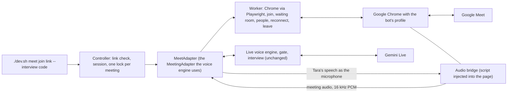

# Google Meet bot (Phase 2 foundation)

**Status: built and tested against a local stand-in for Meet in a real Chrome. Not yet run in a real Google Meet** (no bot account exists yet). What is proven and what is not is listed below; read that section before trusting anything.

Tara joins a meeting as a dedicated browser participant, hears the meeting, speaks into it, and runs the existing interview. The voice engine, the gate, the interview flow, scoring, the retry rule and the three-minute question limit are the ones already in the repo; none was rebuilt. The Meet code lives in `src/tara/meet/` and talks to the engine only through the `MeetingAdapter` interface.

## What is available from Google, checked 2026-10-21
| Question | Finding | Source |
|---|---|---|
| Can a bot get live audio from the official Meet Media API? | Not for a normal interview. It is still a **Developer Preview**: the Cloud project, the OAuth principal and **every participant** must be enrolled, and it delivers audio and video of only the three most relevant participants. Sending audio into a meeting is not documented. | Google Meet Media API pages and a Recall.ai write-up, see [SOURCES](../research/SOURCES.md) (M4, M5) |
| Can we create meeting links? | Yes, with the Meet REST API: `POST https://meet.googleapis.com/v2/spaces`, scope `https://www.googleapis.com/auth/meetings.space.created`, needs OAuth. **Not set up here**; for now you create the meeting and pass the link. | Google `spaces.create` reference (M6) |
| So how does Tara get in? | As an ordinary participant through a browser, signed in as a dedicated bot account, with audio handled in the page. | this design |

Using a browser participant instead of an official media API may conflict with Google's terms and can break when the page changes. That risk is accepted knowingly for the first version and recorded here.

## Architecture


### The audio route (the hard part)
Playwright cannot move audio, so the **page** does it, with no system audio device and no extra software:
- **Meeting audio out:** a script injected before Meet loads wraps `RTCPeerConnection`. Every incoming audio track is tapped with Web Audio, mixed to mono, reduced from 48 kHz to 16 kHz PCM16 and sent to Python through an exposed function. Chrome runs with `--mute-audio`, so the bot machine does not play the meeting out loud; the taps are unaffected. With `--per-participant` each participant's own media element is tapped as its own channel instead, and the mixed tap hands over for good on the first channel frame (see [SPEAKER_BINDING](SPEAKER_BINDING.md)).
- **Tara's voice in:** `getUserMedia` is replaced. The "microphone" is a Web Audio destination that Python fills with Tara's 24 kHz speech chunks. Cancelling (barge-in) stops everything queued and reports how many milliseconds were actually played. No camera: a black frame is returned if video is asked for, and the worker also turns the camera off on the pre-join screen.
- **Nothing is recorded or stored.** Audio is passed through and dropped. The only thing on disk is the bot's Chrome profile (its Google cookies), under `work/` which is git-ignored.

Alternatives considered: a virtual audio device such as BlackHole plus system audio capture. It also works, but it needs a driver install, per-machine routing, and cannot separate Tara's output from other sounds; the in-page route needs neither. It stays the fallback if Meet blocks the page-level taps.

### Pieces
| File | Job |
|---|---|
| `meet/controller.py` | link check (`parse`), sessions, one lock file per meeting so two workers never join the same one (stale locks replaced), `create_space` (explains what is missing) |
| `meet/worker.py` | the state machine: launching, joining, waiting room, in meeting, reconnecting, ended, rejected, failed; joins the normal way, **waits to be admitted and never works around it**, rejoins a lost call a bounded number of times, leaves cleanly |
| `meet/browser.py` | Playwright and installed Chrome (`channel="chrome"`, nothing downloaded); the page facade the worker uses |
| `meet/bridge.js`, `meet/bridge.py` | the audio route above, plus the opt-in per-participant channel taps and the speaking-glow scanner |
| `meet/binding.py` | who said what: correlates a channel's energy with Meet's speaking glow, and refuses a name it cannot earn |
| `meet/adapter.py` | turns worker events and bridge audio into the events the engine already reads, sends Tara's audio, supports stop |
| `meet/selectors.py` | every label the bot looks for on Meet pages, in one place (unverified, see below) |
| `meet/run.py` | `check`, `login`, `join` |
| `voice/app.py` | small additions: `defer_opening` and `say_pending_opening`, so Tara greets when the candidate joins, not when she arrives |

### Who is the candidate
By default Meet gives one mixed audio stream. For an interview with **exactly one other person** in the room, their audio is labelled as the candidate and the existing interview rules apply. With two or more other people the audio is labelled `mix`, which the engine treats as an unknown speaker, so the interview rules keep Tara quiet and the screen says so.

With `--per-participant` the bridge taps each participant's own media element instead and `meet/binding.py` correlates that channel's energy with Meet's speaking glow. A channel whose name is earned carries the participant's id; one that is not earned stays `ch-<n>`, which the engine treats as unknown. So two people become two labelled streams rather than one anonymous `mix`, and a name is never guessed. This is the first half of M3 and is **off by default** because it has not been run in a real Meet; see [SPEAKER_BINDING](SPEAKER_BINDING.md). Real per-person identity for the interview report is still M3 in [GOOGLE_MEET_INTEGRATION](GOOGLE_MEET_INTEGRATION.md).

### Interview behaviour in Meet
Unchanged: the greeting and name check, one question at a time, semantic evaluation, one retry, the three-minute limit, the report. In Meet the opening is held until the candidate is in the room.

## What was verified and what was not
**Verified (real Chrome 155 driving local pages, automated tests in `tests/meet/test_meet_browser.py`):**
- meeting audio reaches Python as 16 kHz PCM with energy, attributed to the candidate for one person and to `mix` for two;
- with `--per-participant`, two participants are heard on their own channels and named from Meet's speaking glow (`a` for the candidate, `p-sam` for the second person), the mixed tap stops for good once a channel carries the meeting, and the bot's own preview never becomes a channel;
- Tara's speech comes out of the page as a microphone that a far side measures, ends when she finishes, and goes silent after a stop; the stop reports a plausible played time and a stopped utterance id stays stopped;
- the waiting room is waited in, then entered when someone admits; a denial is reported as rejected; people joining and leaving become events; leaving frees the lock and closes the browser;
- a dead browser page is replaced and audio resumes (`reconnected` event);
- the real voice engine (with a fake Gemini session) receives the meeting audio and its reply is spoken into the meeting.

**Verified offline without a browser (`tests/meet/test_meet_unit.py`):** link parsing, locks and duplicate prevention, the join and watch state machine (waiting-room timeout, denial, ended, not signed in, unknown screen, lost call and give-up), the adapter's attribution, ended-stream and cleanup behaviour, and the command-line refusals.

**Verified offline without a browser (`tests/meet/test_binding.py`):** the speaker binder's rules — a name is attached only after enough agreeing evidence, near-ties and exact ties claim nobody, a quiet channel never earns a name, the bot's own tile is never bound, evidence decays, and bad input is refused. See [SPEAKER_BINDING](SPEAKER_BINDING.md).

**Not verified:**
- anything on the **real** Google Meet site: the selectors in `meet/selectors.py` are written from how Meet labels its controls and may not match today's page or the account's language; the stand-in page (`tests/meet/fixture.py`) only has controls with those same labels;
- that Google lets an automated browser stay signed in, and that its page does not block or change the audio taps (the `RTCPeerConnection` wrap, `getUserMedia` replacement and the muted audio element);
- real audio quality, delay and echo over a real call, and a real Gemini Live interview through the bridge;
- people-list reading: Meet only shows the list while the People panel is open, and its markup is a guess;
- **per-participant naming**: whether today's Meet still matches the tile selectors, `span.notranslate`, `data-self-name` and the speaking class names, and whether it really gives one media element per participant. If it does not, every channel stays `ch-<n>` (unknown), never wrong; nothing has been measured for cost or latency in a real call. See [SPEAKER_BINDING](SPEAKER_BINDING.md);
- recovery from a real network drop, and a long (30 minute) meeting.

## Exact steps for the first real test
1. `pip install -e ".[meet]"` (done already if `./dev.sh meet check` shows Playwright installed). No browser is downloaded; the installed Google Chrome is used.
2. Create a **dedicated Google account for the bot** (not yours). Use a name people will recognise.
3. `./dev.sh meet login`: a normal Chrome window opens with the bot's own profile. Sign the bot account in, then **close that window** (Chrome allows one window per profile). Google may ask for phone verification; that is yours to complete.
4. `./dev.sh meet check`, then `./dev.sh meet probe <your meet link>`: it must list a Google sign-in cookie (for example `SID`) and show a join button or an "ask to join" button. If it says NONE, the sign-in did not save; repeat step 3.
5. Create an interview: `./dev.sh interview new "Candidate Name"` and note the code.
6. In your own account create a Meet (meet.new) and copy the link. If the meeting asks people to knock, you will admit the bot.
7. `./dev.sh meet join <link> --interview <code>`. Watch the `[meet]` lines: `joining`, `waiting_room`, `in_meeting`. **Admit the bot** from your Meet window.
8. From another device or browser join the same Meet as the "candidate". Tara should greet by name, ask "You are ..., right?", then run the questions. Ctrl+C ends the interview and writes the result and report.

Report back, for any failure: the `[meet]` and `[problem]` lines, and which screen the bot was on. A message such as "could not find a join button on the pre-join screen" means a selector in `meet/selectors.py` no longer matches and needs one change.

## First real attempt, 2026-10-21 (what it showed)
The first `join` against a real meeting ended with "the bot is not signed in". `./dev.sh meet probe <link>` (added after, joins nothing) showed the real cause:
- the bot profile had **no Google sign-in cookies** (only two non-sign-in cookies), so the login had not completed or not been saved;
- Meet answered an anonymous visitor with **"You can't join this video call. No one can join a meeting unless invited or admitted by the host."** So the bot must be signed in to a Google account, and the meeting must let that account in (invite its address, or let it ask to join and admit it).
Two changes followed: the worker now reports that refusal clearly instead of "not signed in", and Chrome is started with the real macOS keychain (not Playwright's mock one) so a sign-in saved by a normal Chrome window can be read; macOS may ask once to allow it. Both are unverified until the bot is actually signed in.

`./dev.sh meet probe <link>` prints the Google sign-in cookie names found (names only), the visible buttons and inputs, the first lines of page text, and saves a screenshot to `work/meet/probe.png`. Run it after `meet login` and before `meet join`; it should say a sign-in cookie exists and show a join button.

## Normal meetings and the first real join
`./dev.sh meet join <link>` joins for a **normal meeting** (no interview): the person in the room is the organizer and Tara answers when they speak. `--address-only` makes her answer only when called by name (use it with several people), `--section NAME` and `--type` pick the memory section and meeting type, and `--transcripts` prints what she heard and said, which is the quickest way to see whether the audio route works. Add `--interview <code>` for an interview.

The first real join got the bot into the meeting but Tara did not respond. The likely cause (not confirmed) is that interview mode only lets Tara answer the candidate, and the candidate is recognised from Meet's People list, whose markup is unverified; if the list is not read, the audio is labelled as an unknown mix and Tara stays quiet. Normal-meeting mode does not depend on that. The bot now also reports, on screen: `hearing the meeting` the first time loud audio arrives, `people in the meeting: ...`, `Tara spoke for N s` after each reply, and every 20 s an `audio check:` line (meeting audio tracks captured, frames received, level, how many times Meet opened the microphone). After 30 s it prints a WARNING if no incoming audio track was captured or Meet never opened the microphone. Send those lines when something is silent.

## Second real run, 2026-10-21 (what it showed)
The bot joined a real meeting for the first time (`in_meeting`, people list read, 3 incoming audio tracks captured, Meet opened the microphone 3 times), but the tap level stayed 0.000 and Tara never replied, so she heard nothing. Findings and changes:
- The people list contained icon-font text (`frame_person`, `keep_outline`); those are now dropped (`real_names`).
- A local check with the stand-in showed the speaking path works with the **real Gemini Live service**: Tara's reply reached the far side of a Chrome call at a clear level (peak 0.267), and the receiving tap also works in a visible (non-headless) Chrome with and without `--mute-audio`. So the remaining question is whether real speech reaches the bot.
- WebRTC's `totalAudioEnergy` stays 0 for a muted listener, so it is not used. The diagnostics now print, every 20 s, how many audio packets arrived and their **average size** (about 3 bytes means silence, 40 or more means someone is speaking; measured locally: 3 bytes silent, 80 bytes for a tone) next to the loudest level the tap has heard. They warn when speech-sized packets arrive but the tap is silent (a bridge problem) and when only silence arrives (nobody audible, or the speaker is muted in Meet).

## Third real run, 2026-10-21: the cause of the silence
The diagnostics showed speech-sized packets (104 to 126 bytes) arriving over WebRTC while the tap heard nothing. Cause: the bridge lists a fake speaker ("Tara speaker") so Meet believes a device exists, and Meet routes its playback to the output it lists; `setSinkId` on a device that does not exist fails (`SecurityError`, reproduced locally), and when that fails the remote audio never starts flowing. The bridge now accepts `setSinkId` for its own fake id (elements and AudioContext). The local stand-in page now behaves like Meet (it only starts playing if choosing the speaker worked), so the regression test fails without the fix and passes with it. Verified only locally; the next real run shows whether Meet agrees.

## Fourth real run, 2026-10-21: still silent, better measurement
The `setSinkId` fix did not by itself change the result: 3 audio tracks, WebRTC packets arriving (about 130 to 190 bytes each, which is large even for quiet audio, so packet size cannot tell speech from silence on Meet), and the tap still at 0.000. Two things were learned and added:
- **A ground-truth level.** `RTCRtpReceiver.getSynchronizationSources()` reports the audio level carried in Meet's own RTP packets, independent of our tap and of playout (locally it follows a tone exactly: 0 silent, 0.355 for a 0.5 amplitude tone). The diagnostics now print the loudest level Meet's packets report next to the loudest the tap heard, and the warning is decided by comparing the two: speech on the wire with a silent tap is a bridge problem; silence on the wire means nobody audible or the speaker is muted in Meet. If Meet sends no level information the wire level can read zero, which the message says.
- **Two tap changes to try on real Meet:** the helper audio element is no longer muted (the browser flag already silences output, and a muted element may not make Chrome pull remote audio), and the tap uses the stream Meet itself plays when that stream carries just that one track. Both pass the local tests; whether they matter on real Meet is unknown. A `tapped tracks:` line now reports each track's state once.

## Run log
Every `meet join` writes `work/meet/last-run.log` (git-ignored, replaced each run): all the `[meet]` lines, and every 20 s a `debug` line (what Meet did with its audio since the last check: peer connections created, `getUserMedia` constraints, speaker selections, each tapped track and when it was muted or unmuted, and WebRTC's own per-stream counters: packets, samples decoded, concealed samples, level, energy) and a `status` line (the bridge's own counters). `[heard]` and `[said]` lines are written only with `--transcripts`. It holds no audio. Attach or paste it when something is silent.

## Two audio routes
`TARA_MEET_AUDIO` (or `meet join --audio`) chooses how meeting audio gets to Tara and her voice into the meeting.

| Route | How | Needs | Status |
|---|---|---|---|
| `page` (default) | scripts inside the page tap incoming WebRTC audio, anything the page plays through its own audio context, and media elements (and, with `--per-participant`, one channel per participant); Tara's voice is a replaced microphone | nothing to install | works against the local stand-in in Chrome; on real Meet the standard WebRTC tap heard silence in four runs (decoded-sample counter stayed 0), so the two other taps were added and are untested on real Meet. `--per-participant` is a page-side tap too, so it inherits that |
| `devices` | Chrome's speaker is a virtual cable "BlackHole 2ch" that Tara reads; Chrome's microphone is a second cable "BlackHole 16ch" that Tara plays into | the two cables installed once | the route other open-source Meet bots use (web search, see SOURCES M7 to M9); cable handling and device mapping tested offline and with Chrome's fake device; **not run with real cables yet** |

Devices mode: two cables, never one (a single loopback would feed the meeting back into itself). The cables are not the system default, so the rest of the Mac keeps its sound: the page's `enumerateDevices` is filtered to the two cables and any speaker choice Meet makes is forced to the meeting cable, and the microphone request is forced to the voice cable with echo cancellation and noise suppression off so her voice is not processed. `--mute-audio` is not used in this mode (it would silence the cable). Tara's mono voice is copied to both channels.

Install the cables once (macOS):
```bash
brew install blackhole-2ch blackhole-16ch      # asks for your password
sudo killall coreaudiod                        # or restart the Mac, so the devices appear
./dev.sh meet check                            # both cables should say ok
./dev.sh meet join <link> --audio devices --transcripts
```
Names can be changed with `TARA_MEET_IN_DEVICE` and `TARA_MEET_OUT_DEVICE`. Linux servers would use PulseAudio null sinks instead; that is not built. The commercial alternative that avoids all of this is a hosted meeting-bot API, not evaluated here.

## Sixth real run, 2026-10-21: it works, and the echo problem
With `--audio devices` the bot joined a real meeting, heard the speaker (`hearing the meeting`, the cables found, loudest level 0.3 to 0.6) and replied by voice ("Yes, I can hear you clearly"). The first problem seen was her voice breaking up on the person's phone speaker, and the log shows her answering herself ("Hello. How can I help you today?" again and again). Cause (the likely one, not measured): a phone or laptop speaker plays her voice, the same device's microphone picks it up and sends it back into the meeting a second later, Tara hears it as a person speaking, replies to it, and her own playback is cut off as if someone had interrupted her.

`--half-duplex` (or `TARA_MEET_HALF_DUPLEX=1`) fixes this by passing silence instead of the meeting audio while she speaks and for 1.2 s after (the echo is late). The stream keeps flowing so the engine still sees the end of each sound. The cost: nobody can interrupt her by voice. Better still: use headphones or earbuds on the phone (no speaker, so no echo), mute the phone microphone when not speaking, and `--address-only` so she answers only when called by name ("Tara, ...") and stray sounds do not start a reply. Reply-to-all (the default) answers any sound, which is also why she greeted again and again.

## Seventh real run: text but no voice
With `--half-duplex --address-only` the transcript showed her replies but the phone heard nothing, and the log had no `Tara spoke for ...` lines (the previous run, without those options, had them). The `[said]` lines are printed for every reply the model produces, **including replies the speaking gate holds back**: with `--address-only` she may speak only after being called by name ("Tara, ..."), so a plain "hello" produces text and no voice. That is the most likely cause, but an opening reply that was also silent suggests a second reason, so the run log now records the engine's decisions (`[engine] live.gate state=allowed|denied reason=...`, responses, interruptions) and the screen says when she is holding a reply back and why ("Tara has a reply but is staying quiet: you did not call her by name ...").

## Eighth real run: she goes quiet, especially with two people
The log (`[engine] live.gate ... state=allowed` followed by `state=denied reason=floor_timeout`, "Tara has a reply but is staying quiet: someone kept talking") showed her reply being thrown away because her local voice detector still believed someone was mid-sentence, although Gemini had already decided the speaker had finished. Three causes, all fixed:
1. **A stale label stayed "talking" forever.** Audio carried a label that changed with the people list (one other person: the candidate, otherwise `mix`), and the list flickered (the log shows "nobody else yet" appearing repeatedly). Each flip left the old label marked as speaking, with no more audio to end it, so she never got the floor. That is why muting and unmuting helped. Now the label never changes in a normal meeting (only interviews keep the candidate/`mix` rule), the people list must show the same change on two polls in a row (three for an empty list), and the engine drops any stream that has sent no audio for a second (`stale_streams_cleared`).
2. **Steady noise counted as speech.** The detector was a fixed volume threshold. A noisy microphone, hiss, music or a second device in the room keeps it "speaking" without a pause. The Meet bot now uses an adaptive detector that follows the background level, and one stream "speaking" for more than 6 s without a pause is treated as background (`ambient_streams_ignored`), not a sentence to wait for. A real recent sentence still makes her wait.
3. **Choppy voice.** The cable output now has a higher-latency buffer and holds back the first 200 ms of each reply, so late network chunks do not leave gaps. Meet also has its own **Noise cancellation** setting that can chew up synthetic speech: in the bot's Chrome window open More options, Settings, Audio, and turn Noise cancellation off (the setting is kept in the bot's profile).

Another likely cause of repeated greetings and cut-off speech, with two devices (a laptop and a phone) in the same room, is each device's microphone hearing the other's speaker; use headphones on at least one, and keep `--half-duplex`.

## Limits and safety
- Audio-first: no video is sent or read. The architecture leaves room for reading a shared screen later (a worker method that screenshots the page), but nothing of the kind exists.
- Nothing is recorded unless `--record` is passed: then the room audio (one file per participant channel with `--per-participant`) and Tara's own voice are saved as WAV under `work/meet/recordings`, and the run tells you the folder so you can tell everyone in the meeting first. Nothing is uploaded.
- Credentials: none in code or settings. The Google sign-in lives only in the bot's Chrome profile (`TARA_MEET_PROFILE_DIR`, default `work/meet/profile`, git-ignored). Treat that folder like a password.
- The bot never approves itself, never bypasses the waiting room, and gives up (reported, not forced) if nobody admits it within `TARA_MEET_ADMIT_TIMEOUT_S`.
- One worker per meeting: a lock file in `TARA_MEET_LOCK_DIR` stops an accidental second join (a stale lock from a dead process is replaced).
- Creating Meet links by API needs OAuth and is not built; an interview with more than one candidate needs M3 (per-person identity).
