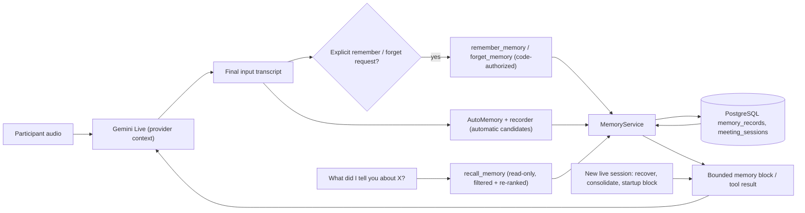
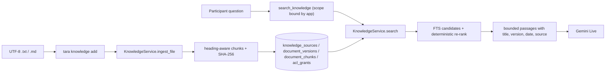
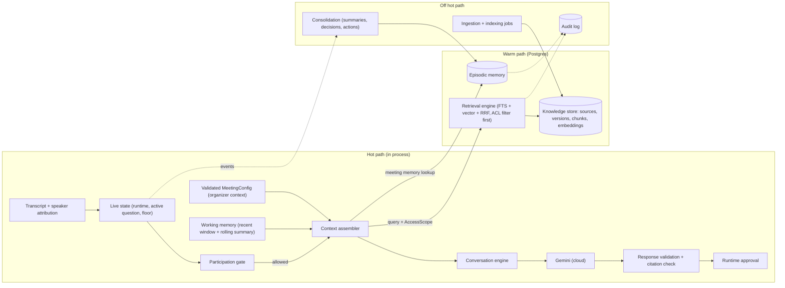
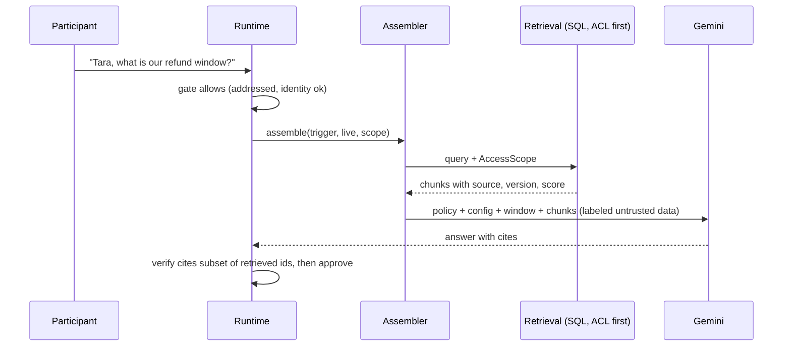
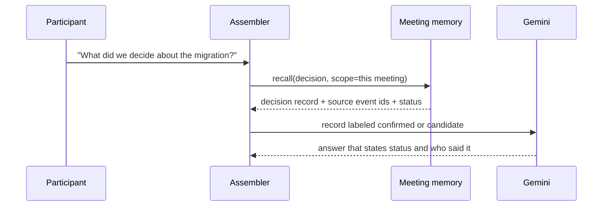
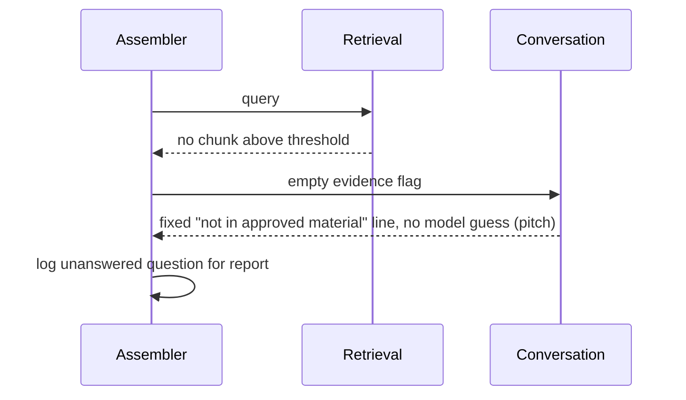
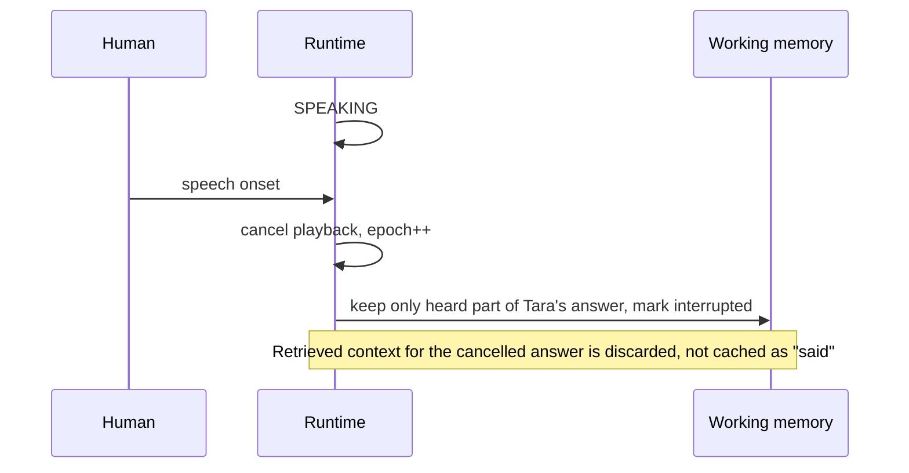
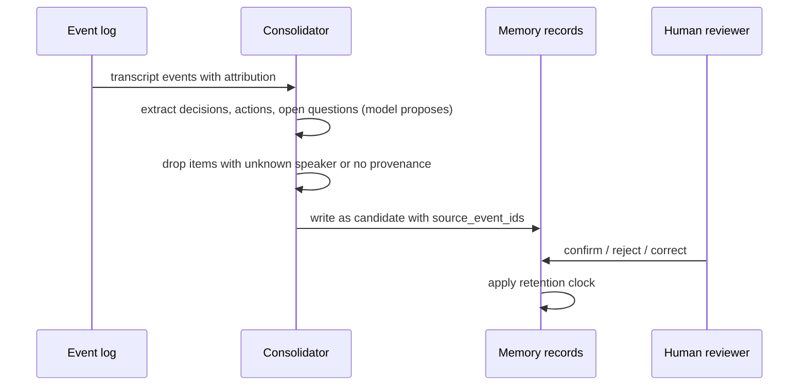

# Memory and RAG Architecture

**Status: Partially implemented (2026-10-23). Built: PostgreSQL long-term memory (`src/tara/memory/`), explicit `remember_memory` / `recall_memory` / `forget_memory` tools, automatic meeting notes and transcript chunks, durable session summaries, filtered and re-ranked cross-meeting retrieval, conservative consolidation, correction linking, bounded startup context, restart recovery, tenant+user isolation, and approved-document RAG (ingestion, chunks, immutable versions, read ACLs, section scope, soft/hard deletion, `tara knowledge` CLI and the Live `search_knowledge` tool), with offline tests and opt-in real-Postgres tests. Not built: embeddings/pgvector or any vector store, Redis, per-turn live context assembly, document write/admin/group ACLs, Row-Level Security or an audit log. Real Gemini tool-calling behaviour has not been verified.** Research: [RAG_TECHNOLOGY_EVALUATION](RAG_TECHNOLOGY_EVALUATION.md). Related: [DOCUMENT_RAG](DOCUMENT_RAG.md), [CONTEXT_ASSEMBLY](../engine/CONTEXT_ASSEMBLY.md), [MEMORY_DATA_MODEL](MEMORY_DATA_MODEL.md), [MEMORY_AND_RETRIEVAL_SECURITY](MEMORY_AND_RETRIEVAL_SECURITY.md), [RAG_AND_MEMORY_EVALUATION](RAG_AND_MEMORY_EVALUATION.md), [MEMORY_OPERATIONS](MEMORY_OPERATIONS.md), [ADR-0016](../adr/0016-memory-retrieval-consolidation-recovery.md), [ADR-0017](../adr/0017-document-rag.md).

## What is real today
| Capability | Implementation | Verified by |
|---|---|---|
| Durable memory records | `PostgresMemoryStore`, migrations 001–005 | opt-in real-Postgres tests (`tests/memory/test_memory_postgres.py`) |
| Ownership / isolation | every query filters `tenant_id` **and** `user_id`; scope is built by the app | canary tests for another user and another tenant |
| Explicit save | `remember_memory` tool; handler requires `MemoryWriteGate` set from the participant's final transcript | offline engine/tool tests |
| Automatic meeting notes | `AutoMemory` writes a live note plus a durable candidate; recorder writes chunks, summary and verified facts | offline and Postgres restart tests |
| Cross-session recall | `recall_memory` tool + startup memory block, searching every meeting in the section | shared-store test and fresh-store Postgres test |
| Corrections | explicit `supersedes_id` or a confidently resolved implicit target; ambiguous cases stay flagged; provenance retained | offline and Postgres tests |
| Consolidation | bounded near-identical merge (Jaccard ≥ 0.9, numbers significant) with `duplicate_of`; no destructive merge | offline tests |
| Forget / expiry | soft delete (`deleted_at`) and `expires_at`; excluded from retrieval on read | offline and Postgres tests |
| Deduplication | exact normalized text updates the record; repeated candidates are reinforced, not duplicated | offline and Postgres tests |
| Bounded context | `render_memories` counts the header and caps characters, labels candidates and proposals, dedupes | offline tests |
| Restart recovery | `meeting_sessions.interrupted`, owner pid/host, close at last activity, completed vs abandoned | offline and Postgres tests |
| Failure honesty | a failed write returns a tool error; startup retrieval failure injects nothing | broken-store and simulated-database-failure tests |
| Approved document retrieval | `KnowledgeService` + `PostgresKnowledgeStore`, migration 006; `search_knowledge` tool | offline and real-Postgres document tests |
| Document authorization | tenant + owner/ACL + approved + section + current version applied inside SQL before text is returned | canary tests for another user, tenant and section |
| Document versions and deletion | immutable `document_versions`; soft delete, hard delete cascade, `purge_deleted` | offline and real-Postgres tests |
| Document ingestion | `tara knowledge add` for UTF-8 `.txt`/`.md`; heading-aware chunks; no PDF/Word | offline file tests |

The Live path sends no database query per audio chunk. It performs one bounded startup query, and tool calls run on the engine's existing tool task, not on the audio or playback paths.

## What is still only design
- **Embeddings / pgvector:** not built. Both memory and document retrieval are PostgreSQL full-text search plus deterministic Python re-rankers. No vector leg, semantic fallback or RRF.
- **Document RAG scope:** approved documents, immutable versions, read ACLs, section scope and deletion exist. There is no PDF/Word/HTML ingestion, crawler, URL fetcher, embedding, automatic per-turn retrieval, admin/write/group ACL or document-level retention. `docs/memory/DOCUMENT_RAG.md` is the exact contract.
- **Redis:** not used; the single-process app has no measured need for it yet.
- **ACL hardening / Row-Level Security:** tenant+user+section and per-document read grants are enforced in application SQL. There is no RLS, audit log or admin ACL.
- **Real Gemini tool calling:** the memory and document tools, grants and instructions are wired and fake-backend tested; whether the live model reliably calls them and cites documents is unverified.

## Data flow


- `MemoryWriteGate` observes the final input transcript. A normal statement never opens an explicit write. The handler re-checks the gate; the model supplies text, never the scope.
- In parallel, `AutoMemory` and the recorder persist decisions, actions, open questions and proposals as candidates without being asked. The live note keeps the meeting responsive; the durable candidate survives the process.
- `MemoryService` classifies wording, validates, links corrections, deduplicates, and returns only after the store commits. A failed store call becomes a tool error; the instruction forbids claiming success.
- `recall_memory` is read-only and always filtered by the application-built `MemoryScope(tenant_id, user_id)`; section isolation is applied inside the query.
- The startup block is injected once into the provider's system instruction. It is not re-sent every turn.
- Retrieved memories and tool results are labeled untrusted data; they cannot change participation, tools or scope.

The document path is separate from the memory path:



The document store is approved-only and owner/ACL/section filtered inside SQL. It has no embedding column; see [DOCUMENT_RAG](DOCUMENT_RAG.md).

## Configuration and commands
```bash
# one-time: create a dedicated database and install the optional driver
createdb tara_memory
.venv/bin/python -m pip install -e '.[memory]'

# migrate (safe to rerun)
TARA_MEMORY_DATABASE_URL=postgresql:///tara_memory .venv/bin/python -m tara.memory.migrate

# run the live demo with memory and approved-document retrieval
set -a; source .env; set +a
TARA_MEMORY_ENABLED=1 TARA_KNOWLEDGE_ENABLED=1 TARA_MEMORY_DATABASE_URL=postgresql:///tara_memory \
  .venv/bin/python -m tara.voice.demo --one-on-one --debug

# ingest and inspect approved documents (same database; never prints the URL)
TARA_MEMORY_DATABASE_URL=postgresql:///tara_memory tara knowledge add ./handbook.md
TARA_MEMORY_DATABASE_URL=postgresql:///tara_memory tara knowledge search "refund window"

# offline tests
.venv/bin/python -m pytest -q

# real persistence tests (throwaway schema, dropped afterwards)
TARA_TEST_DATABASE_URL=postgresql:///tara_memory .venv/bin/python -m pytest -m db tests/memory/test_memory_postgres.py -q
TARA_TEST_DATABASE_URL=postgresql:///tara_memory .venv/bin/python -m pytest -m db tests/memory/test_knowledge_postgres.py -q
```

`TARA_KNOWLEDGE_ENABLED=1` requires `TARA_MEMORY_ENABLED=1` and the same PostgreSQL URL. The full settings table is in [DOCUMENT_RAG](DOCUMENT_RAG.md).


## Core rule
**Live state is not retrieval.** Who is speaking, what was just asked, whether Tara may speak and whether she was interrupted live in process memory and are read in microseconds. Vector search never answers those. Retrieval supplies *background facts* only.

## The eight layers
| # | Layer | Lives in | Written by | Read by | Latency class |
|---|---|---|---|---|---|
| 1 | Live conversation state | process memory (`MeetingRuntime`, transcript deque, `InterviewEngine`) | engine | participation gate, assembler | in-process |
| 2 | Working memory | process memory, rebuilt per turn | assembler + rolling summarizer | assembler | in-process |
| 3 | Episodic meeting memory | process memory for the live copy (`voice/memory.py`); `memory_records` kinds `episode`/`summary` and per-note candidates persisted | turn observer, recorder, minutes | assembler (same meeting), retrieval (later meetings) | in-process; DB off the audio path |
| 4 | Long-term knowledge | `memory_records`; `knowledge_sources`, `document_versions`, `document_chunks`, `acl_grants` | explicit tools and automatic candidates; owner CLI ingestion with approval | retrieval and `search_knowledge` | DB read, bounded |
| 5 | Retrieval engine | PostgreSQL FTS candidate search + `memory/retrieval.py` re-ranker and filters | n/a | tools, startup block | budgeted |
| 6 | Context assembler | startup memory block (`MemoryService.startup_context`); full `ContextAssembler` only in the dormant cascaded path | n/a | Live session start / `ConversationEngine` | in-process |
| 7 | Memory consolidation | bounded `MemoryService.consolidate` at session start; corrections and dedupe on write | n/a | writes layer 3/4 | off the hot path |
| 8 | Authorization and governance | code + DB constraints | admins | every read/write | on every call |



The diagram is the target architecture. Implemented today: `memory_records`, `meeting_sessions`, automatic meeting notes, filtered FTS retrieval with a Python re-ranker, consolidation, the startup block, and the document store with FTS retrieval and read ACLs. The vector leg, embeddings, per-turn assembler, indexing-job pipeline and audit log are not built.

## Components and contracts (implemented)

```python
@dataclass(frozen=True)
class MemoryScope:            # built by the app from the authenticated meeting, never by the model
    tenant_id: str
    user_id: str
    meeting_id: str | None    # section slug for memory and document scope

class KnowledgeStore(Protocol):
    async def ingest(self, scope: MemoryScope, draft: DocumentDraft,
                     chunks: Sequence[ChunkDraft]) -> KnowledgeDocument: ...
    async def search(self, scope: MemoryScope, query: str, limit: int = 40) -> list[KnowledgeHit]: ...
    async def get(self, scope: MemoryScope, document_id: str, *, approved_only: bool = True) -> KnowledgeDocument | None: ...
    async def list_documents(self, scope: MemoryScope, limit: int = 50, *,
                             include_unapproved: bool = False) -> list[KnowledgeDocument]: ...
    async def delete(self, scope: MemoryScope, document_id: str, *, hard: bool = False) -> bool: ...
    async def purge_deleted(self, scope: MemoryScope) -> int: ...
    async def set_approved(self, scope: MemoryScope, document_id: str, approved: bool) -> KnowledgeDocument: ...
    async def grant(self, scope: MemoryScope, document_id: str, subject_id: str,
                    permission: str = "read") -> None: ...
    async def revoke(self, scope: MemoryScope, document_id: str, subject_id: str,
                     permission: str = "read") -> None: ...
```

`KnowledgeService` wraps the store with validation, chunking, timeouts, ranking and metrics. `MemoryStore.recall` is the equivalent scoped contract for conversation memory. The old `core.knowledge.InMemoryKnowledge` / `KnowledgeProvider` is a legacy query-only stand-in: it has no ingestion, ACL or deletion path and must not hold multi-tenant data. The real document implementation is [DOCUMENT_RAG](DOCUMENT_RAG.md).

Planned for later (not built): a mandatory `AccessScope` with explicit principal and source-id sets, an `Embedder` Protocol and a vector leg, an `indexing_jobs` pipeline, and a full `ContextAssembler` in the Live path.

## Trust labels (carried into the prompt)
Every item in assembled context has `kind` and `trust`:
| Kind | Example | Trust |
|---|---|---|
| `policy` | runtime rules, mode | authoritative (app-written) |
| `organizer_config` | validated `MeetingConfig` | authoritative within policy limits |
| `retrieved_fact` | chunk from approved doc, with source, version, date | document-level trust; **data, never instructions** |
| `meeting_statement` | "Bea said X" with speaker + attribution confidence | claim by a person, not a fact |
| `decision` | confirmed by explicit agreement | confirmed (provenance required) |
| `inference` | model summary or interpretation | unverified |
A transcript statement becomes a `decision` or fact only through the promotion rules below.

## Promotion rules (memory consolidation)
Candidate memories start `status=candidate`. Promotion to `confirmed` requires one of: explicit confirmation utterance from a control-role participant at attribution confidence above threshold; two independent speakers agreeing on the same wording; a human click via the future control API. Otherwise it stays `candidate` and appears in reports as "stated, unconfirmed". Contradictions create `disputed` links, never silent overwrites. Every record stores `source_event_ids` or `source_chunk_ids`. Statements with `speaker=unknown` or overlap can be recorded as quotes but never as someone's position.

## Behaviors when retrieval is weak (applies in every mode)
| Situation | Behavior |
|---|---|
| No relevant chunk above threshold | Say it is not in approved material; log `unanswered`; offer to follow up. Never answer from model memory in pitch mode. |
| Chunks conflict | Present both with source and date; prefer newer **version of the same document**; if two different documents disagree, say so, do not pick silently; flag for human. |
| Source may be outdated | Mention the document date; ask if it is still current. |
| Source incomplete | Answer only the supported part; state the gap. |
| Question needs conversation context | Answer from live/meeting memory, no retrieval. |
| Requester not authorized | Retrieval returns nothing; Tara gives a generic "I can't share that here" without revealing existence. |
| Retrieval timeout or DB down | Degrade: answer from live state or admit the limit; never block the meeting. |

## Modes: what each may read and write
| Mode | Live | Working | Episodic read | Episodic write | Knowledge read | Notes |
|---|---|---|---|---|---|---|
| Technical interview | yes | yes | this meeting | answers, evidence, assessments (per candidate, attribution-gated) | rubric, technical references | Candidate answers never retrieved as "knowledge" |
| General interview | yes | yes | this meeting | same | authorized candidate profile, role description | Profile facts labeled `retrieved_fact`; no invented experience |
| Group interview | yes | yes | this meeting | per candidate only above attribution threshold; else quarantined | rubric | Memory keys include `participant_id` and confidence |
| Company meeting | yes | yes | this meeting + permitted prior meetings of same project | decisions (candidate), actions, open questions | project docs | Cross-meeting only within tenant and project ACL |
| Technical discussion | yes | yes | same | decisions/ADR candidates | API, architecture docs | |
| Product pitch | yes | yes | this meeting | requirements, objections, unanswered | approved product/pricing/policy docs only | `no_commitments` enforced by validator |
| Observation-only | yes | yes | this meeting | notes, decisions, actions | optional | Never speaks; retrieval allowed only if config says so |

## Retention (Proposed defaults; legal review required, see Q8)
Live and working memory: discarded at meeting end. Raw audio: not stored. Transcript events: configurable days (`privacy.retain_transcript_days`), default short. Episodic memories: tied to meeting retention unless explicitly promoted to project memory by a control-role user. Organization-level memories (preferences, recurring participants): **deferred**; requires explicit opt-in design before any storage. Deletion propagation: [MEMORY_AND_RETRIEVAL_SECURITY](MEMORY_AND_RETRIEVAL_SECURITY.md).

## Sequence diagrams
These show the target automatic assembler. Today the document path is an explicit read-only `search_knowledge` tool call; there is no per-turn retrieval or assembler in the Live path.

### 1. Answer from a company document

### 2. Answer from earlier meeting context

### 3. Nothing relevant found

### 4. Interruption while speaking

### 5. Memory update after a meeting

### 6. Preventing cross-organization retrieval
```mermaid
sequenceDiagram
  participant A as Assembler
  participant D as Auth layer
  participant S as SQL
  A->>D: build AccessScope from authenticated meeting (not from model text)
  D-->>A: tenant_id, meeting_id, allowed sources
  A->>S: search with tenant_id and ACL in WHERE (plus RLS as defense in depth)
  S-->>A: only rows in scope
  Note over A,S: Query text can name another org; the scope is not derived from it
```

## ADRs
[0009 pgvector](../adr/0009-postgres-pgvector.md) · [0010 local embeddings default](../adr/0010-local-embeddings-default.md) · [0011 memory trust and promotion](../adr/0011-memory-trust-and-promotion.md) · [0012 memory v1: Postgres FTS](../adr/0012-memory-v1-postgres-fts.md).

## Roadmap
[IMPLEMENTATION_ROADMAP](../product/IMPLEMENTATION_ROADMAP.md) section "Memory and RAG track" (phases R1-R5).

## Open questions
Q-R1..R7 in the evaluation doc; also: who may promote project-level memory; whether recurring-participant memory is wanted at all; summary model choice and cost; whether to store embeddings of transcript events (default no).
