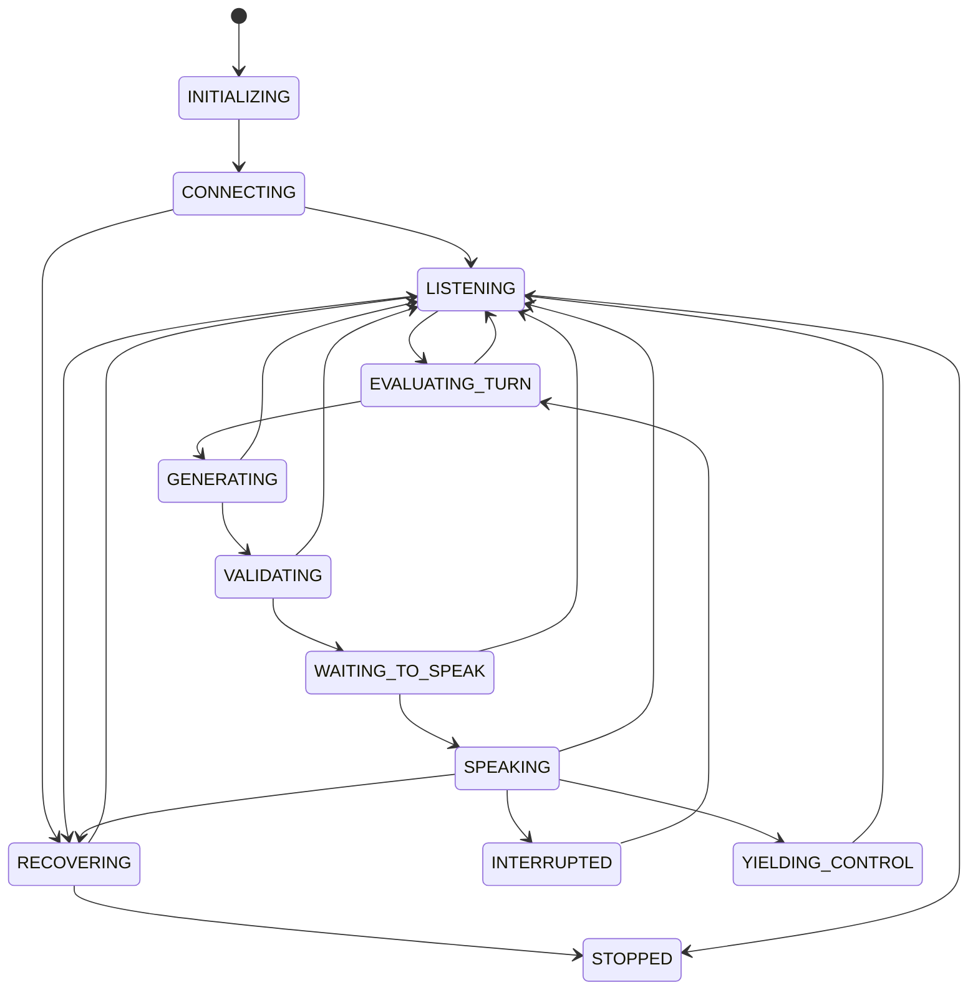

# Meeting Runtime & State Machine

**Status: Designed, not implemented.** The runtime owns truth. Models propose; the runtime approves and acts.

## States (revised; each changes behavior)
| State | Entered when | Allowed actions | Exits on |
|---|---|---|---|
| INITIALIZING | process start / config loaded | validate config, load models | ready → CONNECTING; fail → STOPPED |
| CONNECTING | adapter join requested | wait, retry bounded | joined → LISTENING; fail → RECOVERING/STOPPED |
| LISTENING | joined, floor not Tara's | ingest audio, transcribe, update context | utterance finalized → EVALUATING_TURN |
| EVALUATING_TURN | utterance(s) finalized | run ParticipationEngine gate | allow → GENERATING; deny → LISTENING |
| GENERATING | participation allowed | LLM call (cancellable), tool proposals | proposal → VALIDATING; epoch change → LISTENING (discard) |
| VALIDATING | proposal returned | schema, policy, staleness, grounding check | ok → WAITING_TO_SPEAK; reject → LISTENING |
| WAITING_TO_SPEAK | approved proposal pending | wait for floor free (bounded), re-check staleness | floor free → SPEAKING; stale/timeout → LISTENING |
| SPEAKING | playback started | synthesize+play chunks, track `delivered_ms` | done → LISTENING; barge-in → INTERRUPTED; takeover → YIELDING |
| INTERRUPTED | human speech during playback | stop playback, cancel TTS/LLM, truncate history to delivered | → EVALUATING_TURN (was it addressed to Tara?) |
| YIELDING_CONTROL | takeover detected | stop, acknowledge briefly if policy says, set `takeover_active` | explicit "Tara, continue" → LISTENING |
| RECOVERING | adapter/provider disconnect | reconnect with backoff, bump epoch, mark speech-in-flight as *undelivered* | reconnected → LISTENING; budget exhausted → STOPPED |
| STOPPED | end/fatal | flush report, close resources | terminal |

Removed from the brief's list: separate PROCESSING_SPEECH / IDENTIFYING_SPEAKER states. They are pipeline stages running concurrently *while LISTENING*, not runtime states; making them states would block listening while processing.

Transcription of new speech continues in every state except STOPPED; only the *speaking* path is gated.

## Epochs, staleness, dedupe
- `epoch` increments on: barge-in, takeover, reconnect, topic-changing human utterance addressed to others, config change.
- Every proposal stores `(epoch, trigger_event_id, created_at)`. Approval requires `proposal.epoch == runtime.epoch` and age ≤ configured max (to be tuned) and `trigger_event_id` not already answered.
- **One response per trigger:** `answered_triggers` set keyed by `trigger_event_id`; duplicates from adapter are dropped by `(source, event_id)` dedupe window.
- **Cancellation:** cancelling GENERATING cancels the asyncio task; SPEAKING cancels TTS worker and flushes output buffer; both must be idempotent.
- **Reconnect:** audio sent but unconfirmed is `undelivered`; Tara does not assume it was heard; she may re-ask only if policy allows and the epoch is current.
- **Delivery vs synthesis:** states recorded separately: `proposed → approved → synthesized → playback_started → delivered(ms) | interrupted(ms) | failed`.

## Takeover
Triggers: configured phrases from a participant with role organizer/recruiter *and* sufficient attribution confidence; or an explicit control API call. Then `takeover_active=true`: speak path closed until released.

## Testing
Table-driven transition tests, property test "no SPEAKING when takeover_active", duplicate-event tests, cancellation-race tests ([TESTING_STRATEGY.md](../getting-started/TESTING_STRATEGY.md)).

## Implementation note (2026-10-19, Phase 1)
`src/tara/floor/runtime.py` implements transitions, epochs, takeover, dedupe, and `approve()`. A takeover while Tara is idle or still generating only sets `takeover_active` (state returns to LISTENING); YIELDING_CONTROL is entered only when audio was playing or queued. The simulation harness is `src/tara/sim.py` (fake clock/LLM, scripted intents); scenarios in `tests/floor/test_scenarios.py`. It tests policy logic only.
